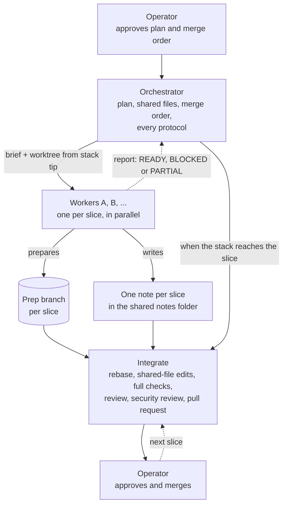

## Executive Summary

- This spell lets one **orchestrator** session farm independent slices of a larger plan out to **worker** sessions, so the slices are prepared in parallel while the protocols run once, at the top of the stack.
- Workers do the work only. Each leaves a **prep branch** plus a short **note** in a shared notes folder and reports back. They never touch the shared files, the stack branches, a pull request, a pipeline or the docs.
- The orchestrator owns the plan, every shared file (version bump, changelog, decision records, progress and architecture notes, lint scope lists, counters), the merge order and every protocol step. When the stack reaches a slice it rebases the prep branch, applies the listed shared-file edits, runs the full checks and the reviews, fixes every finding, commits through `spell-commit-work` and opens the pull request. The operator approves and merges; the orchestrator never does.
- It produces a plan with a footprint comparison, one brief per worker, one note per slice, a slice ledger, and one pull request per slice.
- **Why:** parallel speed without every worker paying the token cost of the full protocols. The protocols are paid once per slice, by the session that owns the shared state.
- **Not this spell:** `spell-full-cycle` and `spell-implement` build a feature end to end in one workspace and serialize by default. `spell-review-batch` reviews many pull requests that already exist. Subagents inside one session are a different mechanism with a different cost model; this spell is for separate sessions with their own context and worktree.



---

## When to use it, and when not to

Use it only when **every** precondition holds:

1. **Disjoint footprints.** No two slices touch the same file, and none depends on another slice's output to be written or tested.
2. **Shared-file edits are listable up front.** You can name every shared file and say, per slice, roughly which edit it will need (a counter to bump, a list entry to add, a section to extend). If you cannot predict them, a worker will discover them mid-run and stall.
3. **No shared sequences.** No migration numbers, generated indexes, lockfiles, fixture IDs or anything else where correctness depends on what another slice picked. Where one exists, the orchestrator allocates it (a range per slice in the brief) or the slices are not parallel.
4. **Each slice is a pull request on its own.** It can be reviewed, merged and reverted without the others.
5. **There is real work per slice.** A slice that takes less time to do than to brief is done by the orchestrator.

Do **not** use it for sequential work, tightly coupled work, one-file refactors, or a plan whose slices keep changing each other. Serialize instead (`spell-full-cycle`, `spell-implement`; ARC-028 R4 in `git-conventions.md`). This spell is the parallel case ARC-028 R4 leaves open: genuinely disjoint footprints.

Footprint overlap is cheap to find now and expensive to find at merge review. Step 0 makes you state the comparison; "they seemed unrelated" is not one.

## Roles

| Role | Does | Never does |
| --- | --- | --- |
| **Operator** | Approves the slice plan, the merge order and each commit; reviews and merges each pull request. | — |
| **Orchestrator** | Owns the plan, the shared files, the merge order and every protocol step (docs, changelog, version bump, review, security review, commit, pull request, pipeline, asking the operator). Starts workers, receives their reports, integrates slices. | Hand a shared file to a worker. Merge a pull request. |
| **Worker** | Does one slice in its own worktree, on its own prep branch. Leaves a note in the shared notes folder and reports back. | Touch a shared file, commit to a stack branch, push to a shared branch, open a pull request, queue a pipeline, write docs or a changelog entry, run the session or review protocols. |

One worktree per slice, cut from the current stack tip. The prep branch is its worker's exclusive territory until the worker reports (`agent-policies.md`, concurrency rule 1); the report is the hand-over to the orchestrator. A worker may use several agents inside its own worktree if they own disjoint files (universal agent rule 27: at most one agent per file); the worker reconciles them and answers for the one branch and one note it returns. A slice that needs separate branches is separate slices.

## Context files

- [governance/git-conventions.md](../../.arcane/governance/git-conventions.md) — branch naming (a prep branch takes the session form of the branch-naming rule, with the slice id as the parallel-subagent suffix), worktree rules (ARC-028), content-verified branch deletion. **If missing**, name each prep branch for what it holds (date, topic, slice id), never with a generated name, and delete only branches whose content is verified merged.
- [governance/agent-policies.md](../../.arcane/governance/agent-policies.md) — an orchestrator starts workers and names the target repository in every delegation; one agent owns a branch at a time (concurrency rule 1). **If missing**, apply the same rules.
- [governance/universal-agent-rules.md](../../.arcane/governance/universal-agent-rules.md) — rule 27 (review the diff, not the summary). **If missing**, do the same.
- The plan, and the shared files it names (`project.md`, `TODO.md`, `DECISIONS.md`, `CHANGELOG.md`, progress notes, whatever the repository uses). **If a file does not exist**, it is not a shared file for this run.
- `.arcane.json` `push_policy`, when present (absent means `open`, as in `spell-commit-work`'s push-policy check). Workers never push, except as Step 2 allows.

This spell works in a repository with none of these: everything it needs is in the plan you write in Step 1.

---

## Orchestrator workflow

### Step 0 — Qualify the work

1. Read the plan or request. If it names fewer than two slices, stop: there is nothing to parallelize.
2. Check the five preconditions above. State the **footprint comparison** in your opening report: per slice, the file and directory globs it will touch; the pairwise intersection (expected empty); the shared sequences found (expected none, or an allocation).
3. If a precondition fails, say which, and either re-scope the slices until it holds or stop and recommend a serial run. Never launch workers on a plan you could not qualify.

### Step 1 — Write the plan

Write it where the orchestrator's own progress is tracked (and keep a copy in the shared notes folder). It holds:

| Field | Content |
| --- | --- |
| Stack and tip | The ordered chain of branches or pull requests, and the commit a worker branches from. |
| Shared files | The explicit list. Everything on it is orchestrator-only. |
| Slices | For each: id, goal, footprint globs, depends-on (normally none), the checks its worker runs, the shared-file edits it is expected to need, any allocated identifiers. |
| Merge order | The order slices reach the stack. |
| Notes folder | An absolute path **outside** the repository, so notes are never committed. If none was given, ask for one. |

### Step 2 — Ask the operator

Parallel sessions are the operator's call. Put one question to them, listing the slice plan and the merge order, and wait for a yes. Two things the plan settles at the same time:

- **Who commits.** Commit authority is not passed along in a brief: in an interactive session every commit needs the operator's exact approval of that diff (`spell-commit-work` step 4.5 and step 8), and no one else's response stands in for it. So by default a worker **leaves its changes uncommitted** on its prep branch (the branch exists, at the base) and the note says `UNCOMMITTED`; the orchestrator commits the slice at integration through `spell-commit-work`. A worker may commit on its prep branch only where that spell's authority table lets it — an autonomous context with validated authority, or a delegation the repository records (`agent-policies.md`, "Solo-Operator Delegation Records") — and then the brief names the delegation and requires the attribution trailers.
- **Pushing.** A worker never pushes. The one exception is a worker on a separate clone (for example a cloud session) that cannot share the local repository: the brief then names the single prep branch it may push and the remote, and only if `push_policy` allows it. Under `guarded`, ask the operator for that push now and say so in the brief; under `blocked`, there is no such worker.

### Step 3 — Start the workers

For each slice, create its worktree yourself from the stack tip named in the plan (`git worktree add <path> -b <prep branch> <tip commit>`), naming the branch in the session form of the branch-naming rule with the slice id in the suffix position, never a generated name; then start a session of its own in that path. Give it the **worker brief** (template below) as its first message. The brief is the only context the worker has, so it carries everything: footprint, off-limits list, authority, checks, note path, and the override below. Do not write "see the conversation".

The repository's own instructions may route a session to the open-session, commit and pull-request spells. The brief overrides that for the worker, and the worker says so on the record (universal agent rule 27).

Start only as many workers as you can integrate. Two to four is the usual range.

### Step 4 — While the workers run

Work your own part of the stack. Do not poll. The note's `Status:` line is the report: check the notes folder whenever you next take a turn, use the client's cross-session messaging where it has one, or have the operator relay the worker's `READY`, `BLOCKED` or `PARTIAL` line. A worker that cannot write the notes folder (a sandbox, a separate clone) puts the whole note in its final message and you save it there. Answer a worker's question once, in a message that names its slice. If the plan changes (a slice dropped, reordered, a shared file added), tell every affected worker and update the ledger.

### Step 5 — Receive and verify each report

A worker's report is a claim, not evidence. Before treating a slice as ready:

1. Read the note. If there is none, see **Failure cases**.
2. Compare the prep branch's actual changes (`git diff --name-status <base>...<prep>` for commits; for uncommitted work `git -C <worktree> status --porcelain --untracked-files=all`, which also lists new files) with the slice's footprint and with the note's file list. A file outside the footprint, or any shared file, is a defect: handle it as a failure case, do not integrate it.
3. Check the prep branch's changed files against every other reported slice for overlap.
4. Mark the slice `reported` in the ledger. Do not merge, rebase or run protocols yet; the slice waits for its turn in the merge order.

### Step 6 — Integrate when the stack reaches the slice

The integration checklist, one slice at a time, in merge order:

1. **Position.** Every slice before this one in the merge order has merged (or is the stack tip you are building on). Confirm the stack tip. Define "stack" once in the plan: a chain of branches whose pull requests each target the previous one, or the trunk with each slice rebased after the last merge.
2. **Take over the branch.** The worker has reported, so the prep branch is yours. Work in the worker's worktree (`git -C <path>`); do not remove it yet, since it may hold the `UNCOMMITTED` changes.
3. **Commit the worker's slice** if it is uncommitted, through `spell-commit-work` steps 1–8 only (staging, trailers, the operator's approval of the exact diff), recording the worker session in the message body. Stop before its push and pull-request steps: those belong to `spell-create-pull-request`, after the reviews.
4. **Rebase** the prep branch onto the current stack tip. A conflict in a file outside the slice's footprint is a plan violation; record it. Then **re-verify scope**: re-run the footprint comparison on the rebased branch.
5. **Apply the shared-file edits** the note lists. The note records the kind of each edit, not final numbers, because earlier slices have moved them: compute the version with `spell-bump` and write the changelog entry from the note's text; apply decision records, progress and architecture notes, lint scope lists and counters against the current tip. An edit the plan did not predict is a finding to record. Commit these separately from the worker's work, through `spell-commit-work` steps 1–8.
6. **Run the full checks** on the rebased tree — the repository's whole gate set, plus the slice's own checks from the plan, not the worker's summary of them. A worker's green result does not carry over a rebase.
7. **Review:** `spell-review`, then `spell-security-review`, on the slice's diff against the stack tip. Docs updates belong here too.
8. **Fix every finding.** Every review and security finding is fixed, or deferred only with the operator's say-so recorded; none is waved through because a worker "already checked". Commit the fixes, then re-run the checks and the reviews.
9. **Open the pull request** with `spell-create-pull-request`, head branch the prep branch, base as the plan's definition of the stack says. The body is yours: what the slice does, the checks you ran, the findings and how each was fixed. Include nothing from a worker's note that you did not verify.
10. **The operator approves and merges.** Report the pull request in the `Needs you` block. You never merge.
11. **After the merge:** mark the slice `merged`; remove the worker's worktree and delete the merged prep branch using the content-verified deletion procedure in `git-conventions.md`. Slices still waiting are rebased at their own turn (item 4), not now.

### Step 7 — Close out

When the last slice has merged or been dropped, update the ledger, record lessons about the plan (every predicted-versus-actual difference in shared-file edits, footprints and gates), and run `spell-close-session`.

---

## Worker mode

A worker is not required to load this spell: the brief carries every rule it needs, which is what keeps the worker cheap. If a worker session does invoke it with `worker <brief path>`, it reads the brief and the **Worker rules** below and **ignores everything above**.

### Worker rules

0. Check the brief first. If it lacks any of the base commit, prep branch, footprint, off-limits list, authority, checks or note path, reply `BLOCKED <slice> brief-incomplete` and stop.
1. Do exactly the slice in the brief. Unrelated problems go in the note under Follow-ups; do not fix them.
2. Edit only files inside the footprint. Never edit a shared file, a lint scope list, a counter, a lockfile, a changelog, a decision record, a progress or architecture note or the version. If you need one, write the edit in the note (see **Failure cases**).
3. Work only on your prep branch, in your own worktree. Do not commit to or switch to a stack branch, push (unless the brief names the one prep branch you may push), open a pull request, queue a pipeline or write docs.
4. Do not run the session, commit, review or pull-request spells, even if the repository's instructions route you to them. Run the checks the brief lists, exactly as listed, and record each command, its result and when you ran it. If a check cannot run or fails, say so; never change a check so that it passes.
5. Leave your changes uncommitted unless the brief names the delegation that lets you commit; then commit on the prep branch only, with the attribution trailers the brief lists.
6. The universal rules still apply: no secrets in files or notes, no real organization, person or product names in anything written to a public repository, generic examples only.
7. Write the note, re-read your own diff against the footprint, then report back.

### Worker brief template

The orchestrator fills this in, one per slice, and sends it as the worker's first message.

```markdown
# Worker brief — <slice id>: <slice title>

You are a worker session for one slice of a larger plan. Do exactly this slice. Unrelated problems
go in your note as follow-ups; do not fix them.

## Where
- Repository: <repository path or name>
- Base: <stack tip branch> at commit <sha>
- Your worktree: <path>, on prep branch `<prep branch name, set by the orchestrator>`, cut from that base
- Notes folder (outside the repository): <absolute path>. Write your note to `<file name>`.

## Your slice
- Goal: <what the slice delivers, in two or three sentences>
- You may change: <footprint globs>. Nothing else.
- Read first / follow: <files, examples, conventions the slice must match>
- Identifiers allocated to you: <ranges or names; anything else is the orchestrator's, or "none">

## Off limits
Shared files, orchestrator only: <the explicit list from the plan>.
You do not: edit those files; commit to or switch to a stack branch; push to a shared branch; open a
pull request; queue a pipeline; write docs, changelog entries or decision records; run the session,
commit, review or pull-request spells. If this repository's instructions route you to any of those
spells, this brief overrides them for this session; say so on the record.
If you need an off-limits file, do not edit it. Write the edit you need in the note (its kind and
content, not final numbers) and keep going. If you cannot finish without it, stop and report BLOCKED.

## Authority
- Commits: <"Leave your changes uncommitted." or "You may commit on your prep branch only, under
  delegation <id>, with these trailers: <list>.">
- Push: <"None." or "Prep branch only, to <remote>, because you run on a separate clone.">

## Checks to run
- <command> — expected: <result>
Run each as written. Record command, result and date in the note. If one cannot run or fails, say so.

## Done means
- The prep branch holds the slice; the note exists at the path above, in the template's shape; you
  have re-read your diff against the footprint.
- If you cannot write the notes folder, put the whole note in your final message.
- Your final message starts with `READY <slice> <prep branch>`, `BLOCKED <slice> <prep branch>` or
  `PARTIAL <slice> <prep branch>`, then the note path, then at most three lines of anything the
  orchestrator must decide. Nothing else.
```

### Note template

The worker writes one per slice in the shared notes folder, named `YYYY-MM-DD-<topic-slug>-<slice>.md`.

```markdown
# Slice note — <slice id>: <slice title>

- Status: READY | BLOCKED | PARTIAL
- Prep branch: <name>   Base: <sha>   Commits: <n> | UNCOMMITTED
- Written: <date>

## Files changed
<`git diff --name-status` against the base. Flag any file outside the footprint.>

## Shared-file edits the orchestrator needs
| File | Exact edit | Why |
| --- | --- | --- |
| <path> | <the kind and content of the edit: the entry to add, the list to extend, the bump level; the orchestrator recomputes numbers at integration> | <what in the slice requires it> |
(None, if none.)

## Checks and results
| Command | Result | Run on |
| --- | --- | --- |
| <command> | <pass / fail / not run: reason, with counts or the failing output's first line> | <date> |

## Gate differences from the plan
<A check that needed to differ, an extra one that mattered, a count that does not match the plan. None, if none.>

## Decisions and deviations
<Anything done differently from the brief, and why.>

## Follow-ups (outside the slice)
<One line each.>

## Open questions for the orchestrator
<Only what blocks or changes integration.>
```

---

## Failure cases

| Case | What happens |
| --- | --- |
| **A worker needs a shared file** | The worker does not edit it. It writes the edit in the note's shared-file table and continues. If it truly cannot proceed (for example a lint scope list must include the new files before the check can run), it works around it locally without committing the workaround, or stops with `BLOCKED` and the exact question. The orchestrator then adds the edit to the plan and to the integration list, or re-scopes the slice. If it happens in more than one slice, the up-front list was incomplete: update the plan and tell the other workers. |
| **Two workers collide** | Found at Step 5 (overlapping changed files) or at rebase. The earlier slice in the merge order keeps the file; the later slice's overlapping hunk is redone on top of it, by the orchestrator when small, by a re-briefed worker when not. Record it as a plan error and serialize those two slices from now on. A collision on an identifier both picked is the same failure: counters belong to the orchestrator, so give each slice its own range. |
| **A prep branch goes stale** | The stack tip moved while the worker worked. Rebase at Step 6; re-run every check on the rebased tree. If the new tip changed files in the slice's footprint, that is a plan violation: if conflicts are small and inside the footprint, resolve them; otherwise start a new worker from the new tip with the old note attached. Never merge a result that was tested before the rebase. |
| **A slice's gates differ from the plan** | The worker records the difference under "Gate differences" and does not alter a gate to make it pass. The orchestrator runs the gates that actually apply at integration, updates the plan for the slices still waiting, and treats a gate that cannot pass without a shared-file change as the shared-file case. |
| **A worker went out of scope** (edited a shared file, committed to a stack branch, pushed, opened a pull request) | Do not integrate the out-of-scope parts: revert them on the prep branch, or discard the branch and restart the slice (discarding goes through the content-verified deletion procedure in `git-conventions.md`, after the operator confirms). Anything already outward-facing (a pushed shared branch, an open pull request) goes in the `Needs you` block for the operator to resolve. Record it so the next brief says the rule louder. |
| **No note, or the worker ended early** | Inspect the worktree read-only. Without a note the slice is unverified. (On a re-run, a slice marked `launched` with no note gets this check before anything is restarted, so a second worker never collides with the first one's branch.) Either write the note yourself from the diff, marked "written by the orchestrator from the diff", and verify the branch fully at Step 6, or restart the slice. Never integrate on a worker's chat summary alone. |
| **The orchestrator's checks fail where the worker's passed** | The orchestrator's result governs. Fix it at integration, or send the slice back with the failing output. |
| **The plan changes mid-run** | Message the affected workers with the change; a worker whose slice was dropped stops and reports. Update the ledger. |
| **The operator declines the plan** | Re-plan with what they accept, or fall back to a serial run. Do not start workers on a plan the operator has not approved. |

---

## Output

The orchestrator keeps one ledger and updates it at every state change.

```markdown
| Slice | Worker session | Prep branch | State | Shared-file edits | Pull request |
| --- | --- | --- | --- | --- | --- |
| <id> | <session> | <branch> | planned / launched / reported / integrating / merged / dropped | <applied / pending / none> | <link or —> |
```

### Reporting

Every report the orchestrator ends a turn with leads with the ledger, then what changed since the last report, then any open failure case with the decision it needs.

<!-- fragment:needs-you:start -->
**Needs you — required operator actions.** When this run leaves an action that only the operator can take, and the work is not correct or complete until it is taken, report it in one block at the very top of the final report, before every other section and before any optional next step:

```markdown
## ⚠ Needs you

- <exactly what to do: the command, the link, or the question> — <why the agent cannot do it itself>
```

- **What belongs in it:** an action the work needs that only the operator can take — approving or merging a pull request, accepting a decision record, answering a question the work is waiting on, confirming a `guarded` push, running an interactive command such as `spell unblock-push`, or a step on an external platform the agent cannot reach. An optional suggestion, a next spell to run, or anything the agent could do itself is not a required action and stays out of the block.
- **One line per action.** Say exactly what to do, then, after the dash, why the agent cannot do it. Write the command, link or question out in full; never point elsewhere with "see above".
- **Never only among optional steps.** An action required for correctness is never listed only under next steps, suggestions, `Carry Forward` or `What's Next?`. It may be repeated there, but it always appears in this block.
- **Omit it when empty.** When nothing needs the operator, leave the block out entirely: no heading and no "None" line.
- **Every final report.** The block belongs in whatever report ends the run, including a report written when the spell stops early.
- **Report it to the presence channel.** When the block is not empty, also run `spell presence report --status waiting --needs-you "<line 1>" --needs-you "<line 2>"`, one flag per line of the block; with no presence channel configured on this machine the command prints nothing and exits 0, so the block itself and the rest of the run are unchanged.
- Enforcement: explicitly advisory prose (ARC-023) — no check reads a spell's actual output for this block; it holds by these instructions alone.
<!-- fragment:needs-you:end -->

## Rules

- **The orchestrator owns the shared state.** Shared files, merge order and every protocol step belong to one session. Never hand a shared file to a worker "just this once": write the edit in the note and apply it yourself.
- **Qualify before launching.** Refuse to start workers until the five preconditions hold and the footprint comparison is stated. Refuse a plan with fewer than two slices.
- **The brief is the only context.** A worker has not seen this conversation; a brief that points at it is incomplete. A worker with an incomplete brief stops (Worker rule 0).
- **Review the diff, not the report.** A note describes what the worker intended. Read the prep branch's actual changes against the footprint before relying on it (universal agent rule 27).
- **Workers run no spell protocols.** Open and close session, commit, review, security review and pull request run once per slice, by the orchestrator, at integration. Every review finding is fixed.
- **Nothing outward-facing without the operator.** The plan in Step 2, the exact approval of every commit, `spell-create-pull-request` for the pull request, and the operator's own merge each gate one step. The orchestrator never merges.
- **Notes stay out of the repository.** The notes folder is outside it; do not commit a note. Briefs and notes carry no secrets and, in a public repository, no real organization, person or product names.
- **Re-run safe.** Running this spell again on the same plan reads the ledger and the notes folder and resumes at the first slice not yet `merged` or `dropped`.

## Acceptance checklist

- [ ] Five preconditions checked; footprint comparison stated; shared files and shared sequences listed.
- [ ] Operator approved the plan and the merge order before any worker started; every commit had the operator's exact approval.
- [ ] Each worker had its own worktree from the stack tip, a compliant prep branch name and a self-contained brief.
- [ ] No prep branch contains a file outside its footprint or on the shared-files list.
- [ ] Every slice has a note; every shared-file edit it listed was applied (or rejected with a reason) by the orchestrator.
- [ ] Checks, review and security review ran on the rebased tree; every finding is fixed; the pull request body states what was run.
- [ ] The operator, not a worker or the orchestrator, merged each pull request.
- [ ] The ledger is current and merged prep branches and their worktrees are removed.
