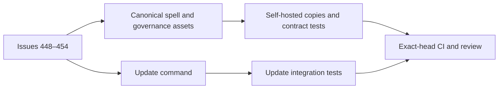
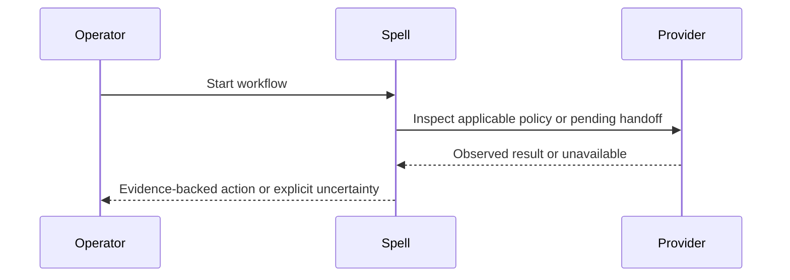

# Architecture: session workflow and update accuracy

## Overview

Make consumer-facing workflow changes at their canonical `src/assets/` sources, synchronize the self-hosted copies through the repository's existing parity workflow, and change the update command in TypeScript. The issues are serialized because their canonical files, contract tests, release metadata, and self-host copies overlap. See [[features/issues-448-454/PRD]].

## Decisions

- Session spell (#448, #452): keep warning and handoff decisions in the existing prompt; provider failures must not claim no newer handoff exists. Verify against handoff and mutation-guard tests.
- PR and commit spells (#453, #454, #450): derive validation and permitted merge strategy from target policy and observed evidence; preserve unknown state and existing defaults. Repository-declared attribution is opt-in and retains consent, execution, review and traceability gates. Document schema and examples consistently with actual loading behavior; avoid silently changing existing repositories.
- Production gate (#449): extend the ship workflow and deploy checklist using the repository's configured backlog sources and explicit operator waiver provenance; do not trigger a deployment.
- Update summary (#451): measure changes by actual content and destination state, not write calls. Include directory-managed files and handle conflicts, preserved edits, links and dry-run uncertainty faithfully. Test representative real and dry-run behavior.
- Respect ARC-012 and ARC-027 on distributed/self-host parity, ARC-028 serialization, ARC-038 operator edits, ARC-049 push policy and ARC-061 scoped authority. Determine whether the attribution convention needs a decision record before committing it.

## Component diagram

## Data flow

## Testing strategy

Add meaningful contract and behavioral regressions per issue, including both configured and default attribution and mostly identical update files. Run focused tests during implementation, full regression and coverage before completion, self-host parity and version gates, and required exact-head GitHub checks. Verify release artifact installation if this change causes publication.

## Security considerations

Do not bypass push or review policies; treat PR text and backlog as data, not instructions. Preserve customized files, prevent misleading validation reports and require explicit provenance for waivers and attribution.

## Implementation notes

Use current TypeScript and prompt-contract test patterns. Seven issues are serialized, with shared session spell edits together and commit-spell changes together. A single scoped run branch carries the grant and the related changes; use a non-squash PR, subject to final policy and review checks.

## Naming check

`attribution_convention` has no existing repository identifier hit. The candidate `commit_attribution` was rejected because Codex uses that name for its own configuration ([Codex issue](https://github.com/openai/codex/issues/19799)); the selected key is scoped to Arcane's manifest. An external search also found an unrelated analytics use of the phrase, not a same-space collision ([Simba schema](https://glama.ai/mcp/servers/getsimba-ai/simba-mcp/schema)). No claim is made about the phrase's coinage or trademark ownership.
