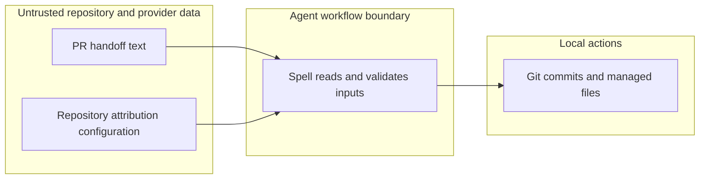

# Security review: issues #448–#454

Scope: the changed update and manifest code and distributed agent workflow guidance. See [[features/issues-448-454/architecture]].

- Prompt injection: session guidance explicitly treats PR contents as data; review and authority checks remain separate.
- Command injection: attribution trailer keys and values are validated as single-line data, and the spell says not to interpret them as shell commands. The configured convention does not grant execution, review, push, or completion authority.
- File safety: update keeps the existing planned-write linked-directory checks, customized-shim preservation, and merge fallback. Dry runs do not write managed files; obtaining an old vendor version is a read needed to predict a merge.
- Secrets: `npm run doctor:leaks` passed on 2026-11-06.
- Dependencies: `npm audit --omit=dev --audit-level=high --json` reported zero advisories. Full `npm audit` reported 10 moderate, zero high and zero critical advisories in development tooling and its transitive dependencies, including Vitest, TypeScript ESLint and minimatch. This change adds no dependency. No dependency upgrades were attempted because they are outside these issues.
- Authentication, cryptography, public endpoints and infrastructure: no new mechanism or infrastructure in this diff. Existing GitHub and Azure DevOps policy and review gates remain in force.

No high or critical issue identified in the changed scope. Dependency findings above remain an existing exposure and are not a claim that all possible vulnerabilities have been ruled out.
