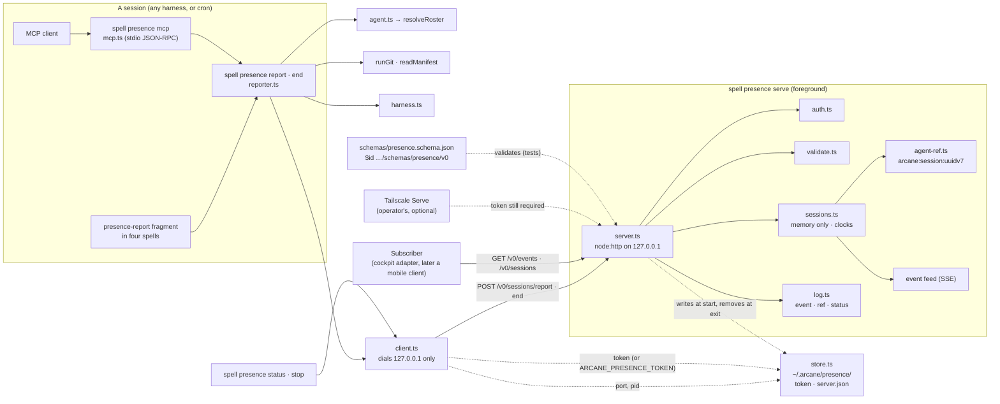
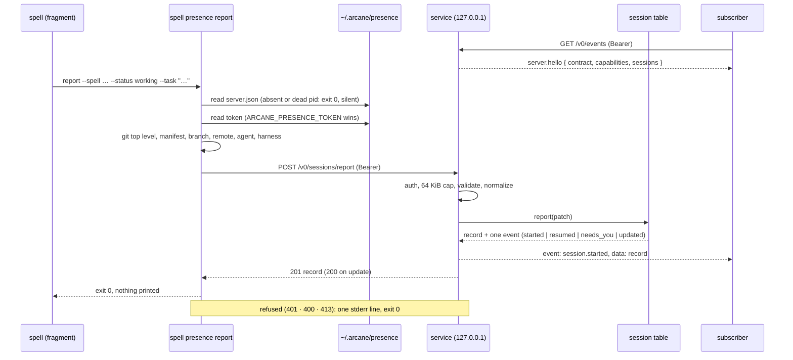
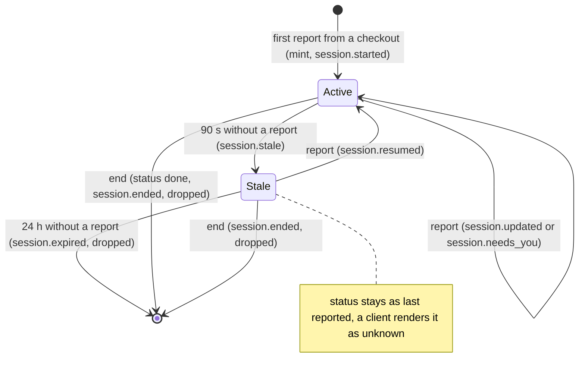

# Architecture — The Presence Channel (`spell presence`, working name `arcane-mcp` v0)

Source: [PRD.md](PRD.md) (PC-01 to PC-21). Decision implemented:
[ARC-060 — The Presence Channel: One Package Behind `spell presence`, a Loopback Contract, Checkout-Keyed Sessions, and a Prompt-Driven Reporting Convention](../../DECISIONS.md#arc-060--the-presence-channel-one-package-behind-spell-presence-a-loopback-contract-checkout-keyed-sessions-and-a-prompt-driven-reporting-convention)
(Accepted 2026-11-04), all twelve decisions and its amendment of 2026-11-05 (decision 13, the
agent block on a v2 roster). It consumes
[ARC-059 — Agent Identity: Opaque Typed References, Roster v3 by Write Path Only, and a Neutral Identity Export](../../DECISIONS.md#arc-059--agent-identity-opaque-typed-references-roster-v3-by-write-path-only-and-a-neutral-identity-export)
(Accepted 2026-11-04): the `arcane:session:` reference type, the capability descriptor and
`resolveRoster`'s provenance.

Written 2026-11-05 against `main` at `2aec288` (arcane-cli 1.17.3). Stories: [stories.json](stories.json)
(PS-01 to PS-16; the Should Haves PS-17 to PS-21, added 2026-11-05 with D24 to D28). Build window: 2026-11-09 to 2026-11-20, ahead of train T3 (2026-12-02).

## Overview

One new command group, `spell presence`, backed by a new module folder `src/modules/presence/`
and one new shared module, `src/modules/agent-ref.ts`. Three processes share one contract: a
foreground **service** (`serve`) that holds sessions in memory and speaks HTTP plus server-sent
events on `127.0.0.1`; a short-lived **reporter** (`report`, `end`) that resolves the checkout,
the repository and the agent and posts one report; and a **stdio MCP server** (`mcp`) that forwards
to the same service, so there is one state. The session table is a pure, clock-injected module
with no I/O; everything that touches the network, the user store or a repository sits in a thin
layer around it. No runtime dependency is added, nothing is installed into a repository, and a
plain install gains inert commands only.

## What was read in the tree (2026-11-05)

Facts the design rests on. Each was checked in the checkout, not inferred.

| Fact | Where | Consequence |
| --- | --- | --- |
| No reference module exists: nothing under `src/` mints or parses `arcane:<type>:<uuid>`. | `src/modules/` has no `agent-ref.ts`; `features/agent-identity/` holds only `PRD.md` | PS-01 builds `agent-ref.ts` to the agent-identity PRD's AI-01 specification, as the PRD's Dependencies section allows. |
| The roster loader refuses `schema_version: 3` ("newer than supported"). | `src/modules/agent-schema.ts`, the `schema_version` check | No roster can carry a reference or an alias until the agent-identity feature ships its loader. ARC-060 decision 13 fills the agent block from a v2 roster meanwhile. See D7 and Risk R1. |
| `resolveRoster` returns `{ roster, definitionsDir, fromUserTier }` and no provenance; `origin` and `definition_revision` are computed by the state export's collector, `collectAgents`. | `src/modules/agents.ts`, `src/modules/state/agents.ts` | The reporter reads the roster through one seam (D7) that calls `collectAgents` for a v2 roster, so AI-07 changes one function. |
| The file rule of ARC-054 — Sign-In from the CLI (decision 3) is implemented as `restrictToCurrentUser` (an `icacls` call on Windows, a no-op on POSIX where the `0600` creation mode already restricts) with a write-to-temp, restrict, rename sequence. | `src/modules/session-store.ts` | Reused for the token file (D13). |
| A loopback `node:http` listener already exists in the CLI (`server.listen(0, "127.0.0.1")`). | `src/modules/oidc.ts` | The bind pattern and its guard test are precedent, not new ground. |
| `resolveRealPath` resolves the nearest existing ancestor and re-appends the rest. | `src/modules/real-path.ts` | Checkout key and store paths (ARC-057 — Managed Paths Stay Inside the Target Directory by Real Path). |
| `remoteProvider` and `stripUserinfo` are exported; `GitRemote` is `{ provider, url }`. | `src/modules/state/git.ts`, `src/modules/state/types.ts` | Reused for `repository.remote`. |
| The state schema ships from `src/assets/schemas/` and `scripts/copy-assets.ts` copies all of `src/assets/`; `ajv` is a devDependency. | `src/assets/schemas/state.schema.json`, `package.json` | `presence.schema.json` sits beside it with no script change. |
| The three-OS CI job (`auth-cross-platform`) runs named test files and does not build. | `.github/workflows/ci.yml` | PS-11 adds a build step there for the timing test. |
| `node dist/index.js --version` takes about 0.14 s here (five runs, macOS, Node 24.18). | measured 2026-11-05 | The 500 ms local budget has room; the Windows runner is the unmeasured risk (R3). |
| `spell state --json` and `spell status` answer "Not initialized" in this repository (the manifest is the self-hosted one under `src/assets/`). | handoff note, re-verified 2026-11-05 | The reporter is silent in this repository too; dogfooding uses a fixture or a consumer repository. |
| Every `features/*/stories.json` in this repository uses the key `stories`, while `development-methodology.md` shows `userStories`. | 12 files read | `stories.json` follows the repository's practice; the document drift is a follow-up, not fixed here. |

## Decisions

Each decision names the ARC-060 decision or PRD requirement it implements. "ADR: none" means the
choice stays inside the accepted record; nothing below needs a new decision record. The one
point that needed an **amendment** to ARC-060 was put to the operator and answered on
2026-11-05 (D7; [Questions for the operator](#questions-for-the-operator)).

### D1 — A module folder with a pure core and a thin shell

- **Options:** one module; a folder with I/O mixed into each file; a folder whose core has no I/O.
- **Decision:** `src/modules/presence/`:

  | File | Role | I/O |
  | --- | --- | --- |
  | `types.ts` | TypeScript twin of the schema; the constants (`CONTRACT = "v0"`, `DEFAULT_PORT = 27226`, limits, clocks) | none |
  | `validate.ts` | Report and end-request validation and normalization (D11) | none |
  | `sessions.ts` | The session table: key, mint, patch, events, stale and expiry (D4 to D6, D10) | none (clock and minter injected) |
  | `auth.ts` | Bearer check in constant time | none |
  | `log.ts` | The service's only logger (D18) | stderr |
  | `store.ts` | `~/.arcane/presence/`: the token and `server.json` (D13, D14) | user store only |
  | `server.ts` | `node:http` listener, router, event feed (D12) | loopback socket |
  | `client.ts` | The loopback client the reporter, `status`, `stop` and the MCP server share (D15) | loopback socket |
  | `agent.ts` | The roster seam (D7) | reads the roster |
  | `harness.ts` | The harness detection table (D8) | reads `process.env` |
  | `reporter.ts` | Builds a report from a working directory (D16) | git reads, manifest, roster |
  | `mcp.ts` | JSON-RPC 2.0 over stdio (D17) | stdin, stdout |

  `src/commands/presence.ts` parses flags and calls these; `src/index.ts` registers `presence` as
  a command group the way `agents` is registered. `src/modules/agent-ref.ts` is outside the
  folder because the agent-identity feature owns it afterwards (D2).
- **Rationale:** the security claims of ARC-060 decision 10 ("no execution, no reads beyond its
  own inputs") become checkable by an import test: the service side (`server.ts`, `sessions.ts`,
  `validate.ts`, `auth.ts`, `log.ts`) imports no `node:child_process`, no git, no manifest, no
  roster and no outbound client (PS-15).
- **ADR:** none; the folder precedent is `src/modules/state/` and `src/modules/show-report/`.

### D2 — The reference module is built here, to AI-01's specification

- **Decision:** PS-01 adds `src/modules/agent-ref.ts`: `uuidv7()` over `node:crypto`
  (`randomBytes`, a 48-bit millisecond prefix, monotonic within a millisecond), `mintRef(type)`,
  `mintAgentRef()`, `mintTemplateRef()`, `mintSessionRef()`, and `parseRef(text)` returning
  `{ type, uuid }` or a one-line reason. Registered types: `agent`, `template`, `session`. Only
  `src/modules/presence/sessions.ts`'s injected minter calls `mintSessionRef`.
- **Rationale:** the PRD's Dependencies section says that if item 2.1 starts before AI-01 has
  merged, 2.1 builds the module to AI-01's specification and AI-01 adopts it. Nothing of AI-01
  exists (read 2026-11-05).
- **ADR:** ARC-059 decision 1; no new record.

### D3 — The schema is hand-written; the root is the session record; envelopes are `$defs`

- **Decision:** `src/assets/schemas/presence.schema.json` (draft 2020-12, `$id`
  `https://arcaneai.net/schemas/presence/v0`), shipped as `dist/assets/schemas/presence.schema.json`.
  The document root validates one **session record**. `$defs` hold `agent`, `capabilities`,
  `needsYou`, `report` (the `POST /v0/sessions/report` body), `end`, `snapshot`
  (`GET /v0/sessions`), `health`, `hello`, `event` and `error`. Every object is closed
  (`additionalProperties: false`). `capabilities.actions` is an array whose items are the enum
  `open | resume | instruct`. `src/modules/presence/types.ts` is the TypeScript twin, and a test
  validates fixtures for every `$def` with `ajv` (devDependency, as today).
- **Rationale:** the state schema's precedent (state-export architecture D2): the contract is the
  public artifact and reads as one. Closed objects make "additive-only from the first stable
  version" enforceable; `/v0/` is not yet that stable version.
- **Timestamps:** RFC 3339 UTC with millisecond precision (`Date.prototype.toISOString`).
- **ADR:** ARC-060 decision 3.

### D4 — A report is a patch on the checkout's record

The PRD fixes the fields and not what a later report does to fields it omits. The fragment's
`waiting` call carries no `--task`; replacing the record would blank the task exactly when the
operator looks at it.

- **Options:** (a) replace the record on every report; (b) patch.
- **Decision:** (b). The reporter sends `status`, `harness`, `repository`, `checkout` and `agent`
  on every call (it resolves them every time), and `spell`, `task` and `message` only when their
  flag was given. In the report body an omitted key keeps the stored value and an explicit `null`
  clears it (`--message ""` sends `null`). `needs_you` is the exception: it is **replaced on every
  report**, by the lines given or by `[]`, so a `working` report after a `waiting` one clears the
  block. `started_at` is set at mint; `reported_at` on every report.
- **Key:** the record is keyed by `checkout.path` as an exact string. The reporter sends the
  worktree's real path (`resolveRealPath` of `git rev-parse --show-toplevel`); the service never
  resolves a path, because it reads no file (D1).
- **ADR:** ARC-060 decision 4; no new record.

### D5 — Exactly one event per accepted request

- **Decision:** every accepted report emits one event, chosen by this precedence:
  `session.started` (the report minted) › `session.resumed` (the record was stale) ›
  `session.needs_you` (the `needs_you` list differs from the stored one) › `session.updated`
  (anything else, including an identical report, which still advances `reported_at`). `end` emits
  `session.ended`; the sweep emits `session.stale` and `session.expired`. Every event carries the
  full record after the change.
- **Contract note, written into the schema's description:** the record is the truth and the event
  name is why the service sent it. A consumer that alerts on "needs you" compares the record's
  `needs_you`, because a first report or a resumed one can carry lines under another event name.
- **Rationale:** PC-08's acceptance is "one event per reporter call in order"; two events for one
  report would break it in the stale case.
- **ADR:** ARC-060 decision 3.

### D6 — An ended session leaves the table at once; `done` is set only by `end`

- **Decision:** `POST /v0/sessions/end` sets `status: "done"` and `ended_at`, emits
  `session.ended` with that record, returns it, and drops it. `GET /v0/sessions` therefore lists
  active and stale sessions only, and the next report from that checkout mints a new reference.
  A report whose `status` is `done` is `400` naming `status` (use `end`). Expiry drops the record
  the same way after `session.expired`.
- **Rationale:** memory-only state keeps nothing it does not need (ARC-060 decision 7), and one
  way to end a session keeps `done` unambiguous.
- **ADR:** ARC-060 decisions 4 and 7.

### D7 — The agent block and the roster seam

- **Shape:** `agent` is always an object with the six keys `ref`, `slug`, `name`, `origin`,
  `definition_revision`, `aliases`. With no agent it is the **null block**: five `null`s and
  `aliases: []`. The PRD's "a session with `agent: null`" means that block; a stable shape is what
  the state export does for its own nullable fields.
- **On a v2 roster the block is filled from the resolved entry (ARC-060 decision 13, the
  amendment of 2026-11-05):** `slug` is the entry's v2 `id`, `name` its display name (`null`
  while unnamed), `origin` is `repo` or `user`, `definition_revision` is `sha256:` of the role
  definition file (`null` when it is missing), `ref` is `null` and `aliases` is `[]`. A reader
  never mints a reference and never writes a roster. The orchestrator's v2 `id` is `main`, so its
  `slug` is `main` until `spell agents sync` migrates the roster; a consumer matches
  `agent.slug` or an alias, as ARC-060's consequences already ask.
- **The seam:** `resolveSessionAgent(targetDir, agentFlag)` in `presence/agent.ts` is the only
  place the presence code touches a roster. It works on **resolved profiles**
  (`{ ref, slug, name, origin, definition_revision, aliases, definition }`, the AI-07 shape)
  from one provider function. Today's provider calls `collectAgents(targetDir)` from
  `src/modules/state/agents.ts`, which already applies the roster precedence and computes
  `origin` and `definition_revision`, and maps each v2 entry to a profile with `slug = id`,
  `ref = null`, `aliases = []`. No roster and a roster the loader refuses both yield no profiles,
  hence the null block: the reporter never fails a spell over a roster (D15).
- **Matching:** `--agent` matches a slug first, then exactly one profile holding an alias of
  that value in any context; no match or more than one match yields the null block (an identity
  is never guessed). Without `--agent` it takes the single profile whose definition is
  `orchestrator`, else the null block (D9). On a v2 roster there are no aliases, so `--agent`
  matches the `id` only.
- **What can be tested in this feature:** the v2 path end to end, against fixtures. The alias
  branch is reachable on disk only through a loader that accepts v3, which the agent-identity
  feature ships (AI-02, AI-07). PS-10 therefore tests alias matching against in-memory profiles.
  PC-05's criterion "`--agent main` resolves the `openclaw` alias on a v3 fixture" is met at the
  seam now and on disk by the agent-identity feature's AI-07 story, which replaces the provider.
  On a v2 fixture `--agent main` already resolves, because `main` is the orchestrator's `id`.
  This is a **recorded deviation** from the letter of PC-05's acceptance (Risk R1).
- **ADR:** ARC-060 decisions 4 and 13, ARC-059 decisions 4, 5 and 8.

### D8 — Harness detection (ARC-060 open question 1: answered)

- **Decision:** `--harness <id>` wins. Otherwise `detectHarness(env)` walks an ordered table in
  `presence/harness.ts` and returns the first match, else `other`. The value is always one of the
  closed enum `claude-code | copilot | codex | openclaw | cron | other`; **`other` is reported,
  never `null`**, so "the reporter could not tell" has one encoding and the field stays a string.
- **A row enters the table only with evidence:** the variable was observed in a real shell of
  that harness and the observation (harness version, variable name, date) is recorded in
  `features/presence-channel/progress.txt`. PS-10 records it for each harness available on the
  implementing machine; a harness with no recorded observation has no row and reports `other`
  until someone adds one. `cron` has no reliable marker and is only ever set by `--harness cron`.
  No variable name is asserted in this document, because none was verified for it.
- **Rationale:** a detection table built from memory would be the unverified claim the working
  protocol forbids, and a wrong harness label is worse than `other`.
- **ADR:** closes ARC-060's first deferred question inside the record; no new record.

### D9 — The orchestrator default (ARC-060 open question 2: kept, isolated, revisited at the first consumer read)

- **Decision:** keep ARC-060 decision 4 as accepted: without `--agent`, the reporter names the
  roster's orchestrator entry when there is exactly one. The rule lives in one function
  (`defaultAgent(profiles)`), and both outcomes are the same wire shape (the agent block, filled
  or null), so reversing it later changes one function and no schema.
- **Why it is not settled here:** the question is whether the default survives the first
  consumer's rendering choice, and that consumer (hub roadmap item 2.2) is not built. Since the
  amendment of 2026-11-05 the default is live from the first release: on a v2 roster a session
  that passes no `--agent` reports the orchestrator (`slug: "main"`), so every spell run without
  the flag lights the orchestrator's seat. **Story-level decision:** PS-10 implements the
  accepted rule; the question is re-read when the first consumer first renders the feed (item
  2.2 starts 2026-11-16, inside this window), and a reversal is an amendment recorded before
  the release.
- **ADR:** ARC-060 decision 4; a reversal would be an amendment.

### D10 — The clocks are constants, injected, and not a `serve` option in v0 (ARC-060 open question 3: answered)

- **Decision:** `STALE_AFTER_MS = 90_000`, `EXPIRE_AFTER_MS = 86_400_000`,
  `KEEPALIVE_MS = 15_000` and `SWEEP_MS = 5_000` are constants in `types.ts`. `createSessionTable`
  takes `{ now, staleAfterMs, expireAfterMs, mint }`, which is what the test clock needs anyway.
  `serve` exposes no flag for them in v0. Both clocks run from `reported_at`.
- **Rationale:** the only known consumer timeout (60 s idle in the first consumer) is handled on
  the consumer's side by ARC-060's own consequences (re-emit on keepalive, or lengthen its
  timeout). A flag added before a second data point would be a guess, and a per-machine clock
  would make "stale" mean different things on two machines. Because the values are already
  injected, a later `--stale-after` is one option and one test, by amendment.
- **ADR:** closes ARC-060's third deferred question; no new record.

### D11 — Limits and normalization

| Limit | Rule | Answer |
| --- | --- | --- |
| Body | Over 64 KiB (65,536 bytes), by `Content-Length` or by bytes read | `413`, connection closed |
| One-line strings (`spell`, `task`, `message`, each `needs_you` `action` and `reason`, `checkout.branch`, `repository.name`) | Control characters including CR and LF become a space, then the string is cut to 256 Unicode code points | accepted, normalized |
| `needs_you` | More than 20 entries | `400` naming `needs_you` |
| `status` | Not one of `working`, `waiting`, `blocked`, `idle` | `400` naming `status` |
| Unknown key, wrong type | Closed shape | `400` naming the field |
| Subscribers | More than 32 open feeds | `503` with `Retry-After: 5` |
| Slow subscriber | More than 1 MiB buffered for one feed | that feed is closed |
| Connections | `server.maxConnections = 128`, `headersTimeout = 5 s`, `requestTimeout = 10 s` | socket closed |

- **`needs_you` over the cap is refused, not cut:** a silently dropped "needs you" line is the
  one loss an operator cannot see, and the hub's instance of the threat-model section verifies
  this limit by a rejected request. The PRD's "carries at most 20 lines" permits either reading;
  this fixes it.
- **The subscriber cap is 32:** PC-08 asks for at least 16; the threat model asks for a limit.
- **ADR:** ARC-060 decision 3.

### D12 — The HTTP surface

- **Authentication runs before everything else:** before routing, before reading a body. A
  request without the exact header `Authorization: Bearer <token>` gets `401`, `Content-Length: 0`,
  `WWW-Authenticate: Bearer` and nothing else, for every method and every path, `OPTIONS` and
  unknown paths included, so an unauthenticated caller learns nothing about the route table. A
  token in a query string or a cookie is not read.
- **Comparison:** `auth.ts` hashes both values with SHA-256 and compares the digests with
  `crypto.timingSafeEqual`, so length never short-circuits.
- **Routes (authenticated):** exactly the six of ARC-060 decision 3. Unknown path `404`; known
  path with another method `405` with `Allow`. Bodies are JSON; an unparseable body is `400`
  `invalid_json`. Errors are `{ "error": { "code", "field"?, "message" } }`.
- **Headers:** `Content-Type: application/json; charset=utf-8`, `Cache-Control: no-store`,
  `X-Content-Type-Options: nosniff`. **No `Access-Control-*` header on any response**, and
  **no `Host` check** (ARC-060 decision 3: Tailscale Serve rewrites it).
- **What that means for a browser page and DNS rebinding:** with no `Host` check, the token and
  the absence of CORS headers are the whole defence, so both are tested as such (PS-06): a
  request with a foreign `Host` and no token is `401`; a preflight `OPTIONS` is `401` with no
  CORS header, so a page cannot send the bearer header at all; a request with an `Origin` header
  and a valid token still gets no CORS header, so a page could not read the answer even if it
  held the token. Hardening beyond this (a `Host` allowlist) would contradict the accepted
  record and is not proposed.
- **Responses:** `GET /v0/health` → `{ ok: true, generator: { name: "arcane-cli", version },
  contract: "v0", capabilities, sessions: <count>, started_at }`. `GET /v0/sessions` →
  `{ capabilities, generated_at, sessions }`, sorted by `started_at` then `session`.
  `GET /v0/sessions/{session}` parses the segment with `parseRef`; anything that is not a
  session reference is `404`.
- **The feed:** `event: <name>` and one `data:` line of JSON per event, no `id:` field,
  `: keepalive` every 15 s, `server.hello` first with `{ contract, capabilities, sessions }`.
  Writes happen synchronously in the order the table emits, on one event loop, which is what
  orders events per session. `Last-Event-ID` is ignored.
- **ADR:** ARC-060 decisions 3 and 8.

### D13 — The token and the store

- **Format:** 32 bytes from `crypto.randomBytes`, written as base64url (43 characters) plus a
  newline. Readers trim trailing CR and LF (CRLF-safe) and reject an empty value.
- **Bind before write.** `serve` opens the listener first and only then touches the store. A
  second `serve` on a busy port, with or without `--rotate`, exits 1 naming the port and changes
  no file; otherwise `serve --rotate` against a running service would replace the token under it.
- **Write:** the directory is created `0700` and re-set to `0700` on every start; the token is
  written to a temporary file created `0600`, restricted with `restrictToCurrentUser` (the
  ARC-054 decision 3 rule: `icacls` on Windows), then renamed. If restricting fails the temporary
  file is removed and `serve` exits 1 without listening further. An existing token is reused and
  its mode re-set; `--rotate` writes a new one. `serve` refuses to start when
  `~/.arcane/presence` or the token resolves, by real path, outside the home's `.arcane`
  directory (a linked directory; ARC-057's rule applied to the store).
- **Read order:** `ARCANE_PRESENCE_TOKEN` when set and non-empty, else the file. The variable
  wins even when it is wrong; the file never rescues it (PC-06).
- **Never elsewhere:** no option of any `presence` subcommand takes a token; `server.json` holds
  none; the logger cannot print one (D18).
- **ADR:** ARC-060 decision 6. `restrictToCurrentUser` is imported from `session-store.ts`
  unchanged; extracting a shared restricted-file writer is left out to keep the sign-in code
  (95 % coverage tier) untouched in this window.

### D14 — Lifecycle: `serve`, `status`, `stop`

- **`serve [--port <n>] [--rotate]`:** port from `--port`, else `ARCANE_PRESENCE_PORT`, else
  `27226`; `0` asks the OS for a free port (the tests use it). `listen(port, "127.0.0.1")` and
  nothing else: no host or bind option exists, IPv6 loopback is not bound. Then the token (D13),
  then `server.json` (`{ url, pid, port, started_at, generator }`, written `0600` by the same
  temporary-file sequence), then one line with the URL. `SIGINT` and `SIGTERM` close the feeds,
  close the listener, remove `server.json` and exit 0. The token stays.
- **`status`:** no `server.json` → "no presence channel is configured", exit 1. Otherwise call
  `/v0/health` with the token: reachable → URL, pid, version, session count, exit 0; not
  reachable → say so, exit 1. `status` never removes a file.
- **`stop` signals only a process the service itself vouches for.** It reads `server.json`,
  calls `/v0/health` with the token, and signals the recorded pid only when health answers and
  its `started_at` equals the file's. Then it waits up to 3 s for the pid to exit and removes
  `server.json` if it is still there (on Windows a signalled process cannot run its handler).
  When health does not answer, `stop` signals nothing, removes the stale `server.json` and exits
  0. A pid read from a stale file may belong to another process by then; this is why it is never
  signalled on the file's word alone.
- **No auto-start:** no code path outside `serve` creates a listener (import test, PS-15).
- **ADR:** ARC-060 decision 2.

### D15 — The loopback client and the silence rule

- **The token is only ever sent to `127.0.0.1`.** The client takes the **port** from
  `server.json` and builds the address itself; the file's `url` is display text. A `server.json`
  edited to point elsewhere cannot make a reporter send the token off the machine.
- **A stale `server.json` is treated as no channel.** Before sending, the client checks that the
  recorded pid is alive (`process.kill(pid, 0)`); a dead pid means not configured. This narrows
  the window in which another local process could bind the port after a crash and be handed the
  token. It does not close it (a reused pid plus a squatted port); that residual is listed in
  Security Considerations for the hub's instance section.
- **One round trip.** The reporter posts the report directly and reads the answer; it does not
  call `/v0/health` first. The observable behaviour is the PRD's: connection refused, timeout or
  an answer that is not the service's → nothing printed, exit 0; `401`, `400`, `413` → one line
  on stderr, exit 0.
- **Deadlines:** 1 s to connect and 1.5 s for the response; the whole `report` or `end` command
  is cut off at 2 s and exits 0.
- **`report` and `end` always exit 0,** a usage error included (one stderr line), through
  Commander's `exitOverride` on those two subcommands: a non-zero exit inside a prompt-driven
  spell makes a session stop to debug, which is the blocking the rule forbids. `serve`, `status`
  and `stop` keep ordinary exit codes.
- **ADR:** ARC-060 decisions 5 and 6.

### D16 — What the reporter reads, in order

1. `server.json`. Absent or stale → exit 0. **Nothing else is read**: no git, no manifest, no
   roster. This is the "byte-identical without a channel" path and it costs one `stat`.
2. The token (D13). Absent → exit 0, silent.
3. `git rev-parse --show-toplevel --git-dir --git-common-dir` through `runGit` (read class).
   Not a repository → exit 0. `checkout.path` is the real path of the top level;
   `linked_worktree` is whether the git directory differs from the common directory;
   `repository.root` is the real path of the common directory's parent when that directory is
   named `.git`, else the checkout path; `repository.name` is its base name.
4. In parallel: `readManifest(checkout.path)` (no manifest → exit 0: outside an Arcane
   repository the reporter is silent); `symbolic-ref --short -q HEAD` for the branch (detached →
   the short commit id, as the state export does); `remote get-url origin` through
   `stripUserinfo` and `remoteProvider`; `resolveSessionAgent` (D7); `detectHarness` (D8).
5. One `POST` (D15).

The reporter writes nothing anywhere. `end` runs steps 1 to 3 and posts `{ checkout: { path } }`.

- **ADR:** ARC-060 decision 4 and PC-05.

### D17 — The MCP surface

- **Decision:** `presence/mcp.ts` reads newline-delimited JSON-RPC 2.0 from stdin and writes
  only protocol messages to stdout; diagnostics go to stderr. `spell presence mcp` prints no
  banner and no update notice. Methods: `initialize` (answers with the client's protocol version
  when it is one the server lists, else the server's newest), `ping`, `tools/list`, `tools/call`,
  `resources/list`, `resources/read`; `notifications/*` are accepted and unanswered. An unknown
  method is `-32601`; an unparseable line is `-32700` with `id: null` and the process keeps
  reading. Declared capabilities: `{ tools: {}, resources: {} }` and nothing else.
- **Tools:** `presence_report` (`status` required; `task`, `spell`, `message`, `needs_you[]`,
  `agent`, `harness`, and `cwd`, the checkout to report for, defaulting to the server's working
  directory) and `presence_end` (`cwd`). Both call the same `reporter.ts` functions as the CLI,
  so they read what the reporter reads and nothing more. `tools/list` returns exactly these two.
- **Resources:** `arcane://presence/sessions` (the `GET /v0/sessions` document) and
  `arcane://presence/capabilities` (the descriptor from `/v0/health`). With no service, both
  tools and both resources answer with the plain text "no presence channel is configured on this
  machine", not an error.
- **The protocol versions listed** are the ones PS-12 verifies against the published MCP
  specification on the day it is built, and records. None is asserted here.
- **`serverInfo.name`** is `arcane-presence`, named for what it is, like the command (ARC-060
  decision 12). It is one more label for the Naming Test to cover; PS-12 greps it for collisions.
- **ADR:** ARC-060 decision 5.

### D18 — The service cannot log a payload

- **Decision:** `log.ts` exports one function, `logEvent(event, session, status)`, whose
  parameters are the event name, a session reference or `null`, and a status or `null`. There is
  no free-text parameter and the service side imports no `console`. Lifecycle lines (the URL
  line, "stopped") are fixed strings. The reporter's one stderr line on a refusal carries the
  HTTP status and the error `code` and `field`, never the message it sent.
- **Rationale:** PC-12 says the service never logs `task`, `message` or `needs_you`; an API that
  cannot accept them is a stronger control than a review habit, and the log-capture test (PS-15)
  then guards the API.
- **ADR:** ARC-060 decision 9.

### D19 — The reporting fragment

- **Decision:** `src/assets/.arcane/spells/_fragments/presence-report.md` holds the PRD's text
  verbatim. Its markers go into the sources of `spell-open-session`, `spell-close-session`,
  `spell-commit-work` and `spell-implement`, and `npm run fix:self-host-parity` expands it into
  the spells, their root copies and every client shim. A test asserts that exactly those four
  spell sources carry the markers.
- **"Byte-identical to 1.17.1 without a channel"** is a property of prose and cannot be executed.
  Its testable half is D16 step 1: in a fixture with no channel, `report` and `end` produce empty
  stdout and stderr and exit 0, so a spell that follows the fragment adds nothing observable.
- **ADR:** ARC-060 decision 5; ARC-039 — Build-Time Spell Compiler, Generated Client Stubs and
  Shared Prose Fragments.

### D20 — The threat-model template section mirrors the hub's rows

- **Decision:** the template section (`src/assets/.arcane/governance/threat-model.md` and its
  root copy) carries the asset, the three actors, and one row per surface in the
  [control traceability table](#control-traceability) below, each with status `Planned`, a
  mitigation that cites the ARC-060 decision, and a "how to verify" column with a generic
  command. An operator's instance document can then be filled row for row.
- **ADR:** ARC-060 decision 10.

### D21 — The timing test

- **Decision:** `test/presence-timing.test.ts` uses the built CLI (`resolveBuiltCli`, skipped
  with the existing reason when `dist/` is absent), a temporary home (`HOME` and `USERPROFILE`)
  and a fixture repository. It starts `presence serve --port 0`, subscribes to `/v0/events`,
  waits for `server.hello`, then 20 times: records the time, spawns `presence report`, and
  records the arrival of that report's event. p95 is the nearest-rank value (the 19th of 20
  sorted). The limit is 500 ms, or 1000 ms when `CI` is set. The 20 values and the percentile are
  printed and copied into the CHANGELOG entry. The three-OS job in `ci.yml` gains a build step
  and runs this file.
- **If a runner misses the budget:** the measured cost is process start (about 0.14 s for
  `--version` here). The fallback, taken only on evidence, is a split entry: `src/index.ts`
  dispatches `presence report` and `presence end` to a chunk that imports no sign-in, keychain
  or prompt code, using tsup's ESM code splitting. PS-11 owns the measurement and, if needed,
  that change.
- **ADR:** ARC-060 decision 11.

### D22 — "Writes only under `~/.arcane/presence/`" is tested by a tree comparison

- **Decision:** the test takes a recursive listing (path, size, modification time) of the
  temporary home and of two fixture checkouts before and after a full cycle (`serve`, reports
  from both checkouts, `end`, `stop`) and asserts the only differences are
  `.arcane/presence/token` and `.arcane/presence/server.json`, and that `git status --porcelain`
  is empty in both checkouts.
- **Rationale:** PC-07 says "a filesystem watch". Recursive `fs.watch` is not available on Linux
  for every Node version in the support range (`engines: >=18`), and watcher events are lossy; a
  before-and-after comparison is deterministic on the three operating systems. This is a
  **recorded deviation** in mechanism, not in what is proven. The operator's manual check on a
  real machine remains a watch, as the hub's instance section describes.
- **ADR:** none.

### D23 — The Should Haves are not in this story set

PC-17 (`spell presence sessions`), PC-18 (every Needs you block reports), PC-19 (MCP resource
subscriptions), PC-20 (a `spell doctor` row) and PC-21 (open-session reads presence) are
"deferred, on the record" by ARC-060's consequences and are the first things the PRD's
Constraints split off. They had no story in the first set (PS-01 to PS-16); the addendum below
(D24 to D28) gives them PS-17 to PS-21. Each is registered in `TODO.md` by PS-16 so the
deferral has a durable location. PC-15 (the decision record) is already met: ARC-060 was
accepted on 2026-11-04.

### Amendments from the review of PR #435 (2026-11-05)

An independent review of the implementation found seven defects; each is fixed on the branch with
a test, and none changes an ARC-060 decision.

- **D15:** `pidAlive` treats `EPERM` (a pid owned by another account) as not alive. Before, a
  stale `server.json` whose pid had been reused by another account's process made the reporter
  send the token to whatever held the recorded port.
- **D11, D12:** the 1 MiB backlog cap is checked before each event after the first, never on
  `server.hello`, which can be large by itself; new caps of 256 sessions (`503 too_many_sessions`)
  and 32 aliases per agent block (`400`, and `maxItems` in the schema); `connectionsCheckingInterval`
  is 1 s so the header and request timeouts bite quickly.
- **D13, D14:** `serve` refuses to start when `server.json` names another live process whose
  service answers, so a second `serve` on another port cannot rotate the token or take the record;
  a server error after listening is logged, not a crash; `stop` keeps the record of a live process
  it cannot confirm for want of a token.
- **D17:** JSON-RPC ids must be a string, a number or null; a legacy version named in `_meta` is
  served as legacy; a wrong-typed tool argument is a tool execution error (`isError`).

### Addendum — the Should Haves (D24 to D28, 2026-11-05)

Written for stories PS-17 to PS-21 after 1.18.0 shipped (`main` `e4a6cd1`). Each fits D1 to D22
and none changes an ARC-060 decision. D23 deferred these; they are now in the story set.

#### D24 — `spell presence sessions` reads the snapshot through the loopback client (PC-17)

- **Decision:** `runPresenceSessions` calls `GET /v0/sessions` through `callPresence`, so the
  token still only goes to `127.0.0.1` and a stale `server.json` still means no channel (D15).
  `--json` prints the document as received (two-space indent) and nothing else on stdout. The
  table has one row per session (`STATUS`, `AGENT`, `HARNESS`, `REPOSITORY`, `BRANCH`, `AGE`,
  `TASK`) and one indented `needs you:` line per entry. A stale record shows `unknown`, the word
  the reporting fragment already uses for a session that stopped reporting. `AGE` is computed
  from an injected clock, so the table has a snapshot test.
- **Exit codes:** 0 with a document, an empty one included. 1 with the wording `status` prints for
  the same failure (not configured, refused token, not reachable). The two commands share one
  function for it, so the wording cannot drift.
- **ADR:** none (PC-17 inside ARC-060 decision 2's command group).

#### D25 — The Needs you fragment reports without checking `status` first (PC-18)

- **Decision:** one bullet in `needs-you.md`, before its Enforcement bullet: report the block with
  `spell presence report --status waiting --needs-you "<line>"`, one flag per line. It does not
  ask the agent to run `spell presence status` first, because `report` is already silent with exit
  0 when no channel is configured (D15, D16 step 1). One command per block is cheaper than two,
  and that silence is what keeps a spell without a channel unchanged in practice.
- **Overlap accepted:** the four spells that carry `presence-report` say the same thing twice.
  Fragments are independent units (ARC-039), and removing the bullet from `presence-report` would
  change v0's four-spell text, which PC-18 says to leave alone.
- **ADR:** none (ARC-060 decision 5's convention, extended as PC-18 specifies).

#### D26 — MCP resource subscriptions, chosen per era (PC-19)

The MCP specification read on 2026-11-05 (pages and quotes in `progress.txt`, PS-19): revision
2026-07-28 replaced `resources/subscribe` with `subscriptions/listen`, a long-lived request whose
notifications carry its id in `_meta["io.modelcontextprotocol/subscriptionId"]`. Legacy revisions
(2025-11-25 and earlier) keep `resources/subscribe` with a plain `notifications/resources/updated`.
The server is already dual-era (PS-12), so each era gets its own mechanism and refuses the other's:

| | Legacy (`initialize`, or a legacy version in `_meta`) | Modern (2026-07-28 in `_meta`) |
| --- | --- | --- |
| Capability | `resources: { subscribe: true }` in `initialize` | the same in `server/discover` |
| Open | `resources/subscribe { uri }` → `{}` | `subscriptions/listen { notifications: { resourceSubscriptions } }`, unanswered while open; `notifications/subscriptions/acknowledged` first, with the subscription id and the honored subset |
| Update | `notifications/resources/updated { uri }` | the same, with the subscription id in `_meta` |
| Close | `resources/unsubscribe { uri }` → `{}` | the client sends `notifications/cancelled { requestId }` (no response is sent); on stdin's end the server answers each open listen with `{ resultType: "complete" }`, then sends `notifications/cancelled` for it |
| The other era's method | `subscriptions/listen` → `-32601` | `resources/subscribe` → `-32601` |

- **What is honored:** only `arcane://presence/sessions` changes. `arcane://presence/capabilities`
  is constant, so a legacy subscription to it is accepted and never fires, and a modern
  acknowledgment leaves it out. The list-changed filters (`toolsListChanged` and the rest) are left
  out of the acknowledgment because the server does not support them. An unknown URI is `-32602`
  "Resource not found", the same as `resources/read`.
- **The source of updates:** one `GET /v0/events` per MCP process (`openEventFeed` in
  `client.ts`, the same endpoint resolution as every other call), opened for the first
  subscription and closed with the last. Each `session.*` event is one update per subscription.
  Losing the feed, and regaining it after a loss or after a first attempt that failed, is one
  update each, because the resource's text changes between the document and "no presence channel
  is configured". While subscribed and down, the feed is retried every 5 s. One MCP process takes
  one of the service's 32 subscriber slots however many subscriptions it holds.
- **Ordering:** the subscribe answer (legacy) and the acknowledgment (modern) wait for the first
  feed attempt, which is bounded by the client's deadlines. A report sent after the answer is
  therefore always seen.
- **Two pages, one teardown:** the subscriptions page says a server that ends a stream SHOULD
  answer the listen request. The cancellation page says it MUST send `notifications/cancelled`.
  The server does both, in that order, when stdin ends.
- **Threat model:** nothing is added that can act. The tools stay two, `actions` stays `[]`
  (control 8). The new capability flag is read-only and reports what the service already
  broadcasts on `/v0/events`.
- **ADR:** none. It is ARC-060 decision 5's surface plus PC-19, under the dual-era choice the
  operator accepted on PR #435.

#### D27 — The `spell doctor` row (PC-20)

- **Decision:** `checkPresenceService` adds one row, "Presence service (ARC-060)". The row is never
  blocking, because the channel is optional:

  | State | Row |
  | --- | --- |
  | No `~/.arcane/presence/` | pass, nothing printed (silent) |
  | Token file readable by group or others (POSIX) | warn, naming the mode |
  | No `server.json` | pass: not running |
  | `server.json` whose pid is not alive | warn: stale, `spell doctor --fix` removes it |
  | `server.json` that does not parse | warn, naming the file; `--fix` leaves it |
  | Live pid, `/v0/health` answers with the token | pass: reachable, URL, version, session count |
  | Live pid, refused or no answer | warn |

- **`--fix`:** `fixPresenceService` reads `server.json` again and removes it only when it parses
  and its pid is still not alive. It never touches the token, a live record or a file it cannot
  parse. On Windows the token's mode is not read, because the token is restricted with `icacls`
  when it is written (D13).
- **ADR:** none.

#### D28 — Open-session reads presence (PC-21)

- **Decision:** one bullet in `spell-open-session`'s Workspace Health Check, after the isolation
  bullet. It runs `spell presence sessions --json`. On exit 0 it lists the sessions whose
  `repository.root` is this repository's and whose `checkout.path` is not this checkout. On exit 1
  there is no channel and the bullet adds nothing. It feeds the footprint rule (ARC-028 R4) with
  work that is live now, not only the list of worktrees.
- **ADR:** none (prose; PC-21).

## Component Diagram

## Data Flow

A report, from the prompt to a subscriber:

The life of one session record:

## Control Traceability

The hub's instance of the threat-model section (a private record, merged 2026-11-05) lists
fifteen surfaces to verify against the shipped build. Every one maps to an automated test in a
named story and to a manual check the operator can run. Two are accepted risks there; their
bounding facts are tested here.

| # | Surface | What makes it true | Automated test (story) | Manual check |
| --- | --- | --- | --- | --- |
| 1 | Listening socket | `listen(port, "127.0.0.1")`; no host or bind option (D14) | Bound address is `127.0.0.1`; a connection to a non-loopback local address is not accepted; `serve --help` snapshot has no host or bind option (PS-08, PS-15) | `lsof` or `ss` on the port |
| 2 | Authentication | Auth before routing, `401` empty, constant-time compare (D12) | Route table with and without the token, wrong token, wrong scheme (PS-06) | `curl -si` with and without the token |
| 3 | Token storage | 32 random bytes, `0600` in `0700`, refusal when restricting fails, `--rotate`, variable wins (D13) | Modes on POSIX, ACL on the Windows runner, injected failure leaves no file, rotation, precedence (PS-05, PS-11) | `stat` on the directory and file |
| 4 | Token exposure | No token option anywhere; no token in `server.json` or any log (D13, D18) | Help snapshot of every subcommand; log capture searched for the token value (PS-15) | `spell presence --help`; grep of `serve` output |
| 5 | Browser and DNS-rebinding reach | No CORS header, bearer header only, no `Host` check so the token is the control (D12) | Foreign `Host` without token `401`; `OPTIONS` `401` with no CORS header; `Origin` with token gets no CORS header; query-string token ignored (PS-06) | a `fetch` from a web page fails |
| 6 | Repository and filesystem writes | Only `token` and `server.json`; the reporter writes nothing (D14, D16) | Tree comparison of home and two checkouts; `git status` clean (PS-15, D22) | a filesystem watch during a run |
| 7 | State persistence | Memory only; 90 s stale; 24 h expiry; empty after restart (D6, D10) | Test clock for both clocks; restart answers an empty list (PS-03, PS-08) | restart, then `GET /v0/sessions` |
| 8 | Forged or poisoned presence (accepted risk) | Observation only: six routes, two tools, `actions: []` (D12, D17) | The router's table is exactly the six routes; `tools/list` is exactly two tools; descriptor value in four places (PS-06, PS-07, PS-12) | `tools/list` in a client |
| 9 | Disclosure to token holders (accepted risk) | Every read route needs the token; the token never leaves the account's store (D12, D13) | Covered by the route table test and the store tests (PS-05, PS-06) | the hub's review of agent file scope |
| 10 | Request limits | D11's table | 65 KiB body `413`; 257-character line cut; 21 lines `400`; 33rd subscriber `503`; the service answers `/v0/health` after each (PS-04, PS-06, PS-07) | oversized `curl` requests |
| 11 | Execution and reads | The service side imports no process, git, manifest or roster code (D1) | Import test over the service-side files (PS-15) | review of the implementing pull request |
| 12 | Logging | `logEvent(event, session, status)` only (D18) | Log capture with a marker word in `task`, `message` and `needs_you`, a path, and the token: none appears (PS-15) | read `serve` output after a run |
| 13 | Remote access | Nothing listens beyond loopback; Tailscale Serve is the operator's, token still required (D14) | Row 1's tests; README section states the rule (PS-08, PS-16) | the operator's tailnet ACL review |
| 14 | Git hooks | Nothing installs `spell presence` into a hook (ARC-060 decision 10) | Search of `.husky/`, every `hooks` directory under `src/assets/` and the installer's hook writers finds no `presence` (PS-15) | grep in each repository after `spell update` |
| 15 | Data leaving the machine | No outbound client on the service side; the reporter's client dials `127.0.0.1` only (D1, D15) | Import test; client test with a `server.json` whose `url` names another host still dials loopback (PS-09, PS-15) | `lsof -p <pid> -i` shows the listener only |

## Testing Strategy

- **Framework:** Vitest (`npm test`), per `testing-standards.md`. `src/modules/presence/auth.ts`
  and `src/modules/presence/store.ts` are authentication and credential storage, so they take
  the 95 % critical tier in `vitest.config.ts`; the rest of `src/modules/presence/**`,
  `src/modules/agent-ref.ts` and `src/commands/presence.ts` take the 80 % standard tier.
- **Pure core first:** `sessions.ts`, `validate.ts`, `auth.ts` and `agent-ref.ts` are tested with
  no socket and no filesystem, with an injected clock and minter.
- **Service tests in process:** `createPresenceServer` on port `0` with a temporary home; a small
  test client for requests and for the event stream (`test/helpers/presence.ts`).
- **Built-CLI tests:** lifecycle (`serve`, `status`, `stop`), the reporter's silence rule, the
  MCP protocol test and the timing test spawn `dist/index.js` through the existing
  `resolveBuiltCli` helper and skip with its existing reason when `dist/` is absent.
- **Fixtures:** `test/helpers/git-fixture.ts` and `state-fixtures.ts` (a repository with a
  manifest, a second worktree, a v2 roster). Every name in every fixture is one of the fictional
  names of ARC-031 — Fictional Venture Names for Examples and a Repository-Wide Privacy Gate.
- **Schema:** every fixture for every `$def` validates; an extra key, an unknown status and an
  action outside the three words each fail.
- **Leak scan:** the denylist scan runs over all presence fixtures and example documents, as the
  state export's does.
- **Three operating systems:** the store tests (modes, ACL), the lifecycle test and the timing
  test run in the `auth-cross-platform` matrix after a build step.
- **Acceptance mapping:** each PRD acceptance bullet is an acceptance criterion of the story
  named in the [coverage table](#prd-coverage).

## Security Considerations

- The fifteen surfaces are in [Control Traceability](#control-traceability). The template section
  (PS-14) ships them as `Planned`; the hub's instance document owns their verification.
- **Same-account processes.** Any process running as the operator's account can read the token
  file and so read and post presence; an agent runtime that runs under that account is such a
  process. ARC-060 decision 6 accepts this (a loopback capability, not a remote credential) and
  the hub's instance records it as an accepted risk. What bounds it is tested: no route or tool
  acts (row 8), and presence is never authoritative.
- **No `Host` check.** Stated in D12: the token and the absence of CORS are the whole defence
  against a browser page, and each has its own test (row 5).
- **Two surfaces this design found that the fifteen rows do not name**, offered to the hub's
  instance section as candidates:
  1. *Port squatting after a crash.* If the service dies without removing `server.json`, another
     local process can bind the port and would receive the bearer token from the next reporter.
     D15's pid check narrows this; it does not remove it. `serve` on a busy port fails closed
     (D13), so the window exists only between a crash and the next `status`, `stop` or `serve`.
  2. *A tampered `server.json`.* The file is not a secret and a same-account process can rewrite
     it. D15 removes the consequence: the client never dials anything but `127.0.0.1`.
- **Signalling.** `stop` never signals a pid on the file's word alone (D14).
- **No secrets on a command line:** no option takes a token (row 4); tests assert it from the
  help output so a later flag cannot slip in.
- **Privacy:** fixtures use fictional names; the service logs references, statuses and event
  names only; nothing here makes an outbound request (ARC-060 decision 9).

## Implementation Notes

- Register in `src/index.ts` beside `agents`: `const presenceCommand = program.command("presence")`
  with the six subcommands. `report` takes `--status`, `--task`, `--spell`, `--message`,
  repeatable `--needs-you`, `--agent`, `--harness`.
- `--needs-you "<line>"` becomes `{ action, reason }` by splitting on the first " — " (the
  Needs you block's own separator), with `reason: null` when there is none. PS-09 implements
  the split and PS-02's schema allows a `null` reason.
- Home resolution: `resolveHomeDir()` from `user-tier.ts`, on every call, so tests set `HOME`
  and `USERPROFILE`.
- Git: `runGit` with the read class. `rev-parse` and `symbolic-ref` are already reads;
  `remote get-url` was reclassified as a read by the state export.
- The service uses `setInterval(...).unref()` for the sweep and the keepalive so they never hold
  the process open after the listener closes.
- Sorting uses code-unit order, never `localeCompare` (a lesson recorded by the state export).
- `ajv` under `nodenext`: import `{ Ajv2020 }` from `ajv/dist/2020.js` with
  `allowUnionTypes: true` (same source).
- Version bump through `spell-bump` (minor: new commands and a new public asset). The CHANGELOG
  entry sits under ARC-060 and carries the measured budget.
- The pre-commit hook runs lint, both typechecks, `check:staged-org-tokens` and
  `doctor --leaks`; fixture content must pass the org-token scan.

## Schedule

Ten working days. The contract is frozen first because the first consumer (hub roadmap item
2.2, starting 2026-11-16) builds against it.

| Phase | Dates | Stories | Exit |
| --- | --- | --- | --- |
| A — contract | Mon 11-09 to Tue 11-10 | PS-01, PS-02, PS-03, PS-04 | Schema, record semantics and limits frozen: PC-03, PC-04, PC-08's event names and PC-10 no longer change shape |
| B — service | Wed 11-11 to Thu 11-12 | PS-05, PS-06, PS-07, PS-08 | `serve` answers every route and the feed on a branch build; a consumer can subscribe |
| C — reporters | Fri 11-13 to Tue 11-17 | PS-09, PS-10, PS-11, PS-12 | A report reaches a subscriber; the budget is measured on three operating systems by 11-16 |
| D — convention, evidence, release | Wed 11-18 to Thu 11-19 | PS-13, PS-14, PS-15, PS-16 | Fragment, template section, control tests, docs, bump |
| Buffer | Fri 11-20 | — | `spell-review`, fixes, the implementing pull request |

Sixteen stories, each one context window: a module with its tests, or one cross-cutting test
file. If the window tightens, PS-12 (the MCP surface) is the only Must that can move without
blocking the first consumer, and moving it is the operator's decision, not a default.

## PRD Coverage

| Requirement | Stories | Note |
| --- | --- | --- |
| PC-01 One package, zero dependencies | PS-01, PS-09, PS-16 | `package.json` dependencies asserted unchanged in PS-16 |
| PC-02 Service and lifecycle | PS-05, PS-08, PS-16 | user-service examples are documentation (PS-16) |
| PC-03 Loopback HTTP contract | PS-04, PS-06 | |
| PC-04 Session record and vocabulary | PS-01, PS-02, PS-03, PS-10 | |
| PC-05 Reporter | PS-09, PS-10 | v2 roster end to end (ARC-060 decision 13); v3 alias criterion at the seam (D7, R1) |
| PC-06 Authentication | PS-05, PS-06, PS-11 | Windows ACL on the CI runner |
| PC-07 Ephemeral state | PS-03, PS-08, PS-15 | tree comparison instead of a watch (D22) |
| PC-08 Event feed | PS-03, PS-07 | |
| PC-09 MCP surface | PS-12 | |
| PC-10 Capability descriptor | PS-02, PS-06, PS-07, PS-12 | four places |
| PC-11 Reporting convention | PS-13 | |
| PC-12 Privacy posture | PS-02, PS-15 | |
| PC-13 Threat-model template section | PS-14, PS-15 | |
| PC-14 Budget and its test | PS-11 | |
| PC-15 Decision record | — | met: ARC-060 Accepted 2026-11-04 |
| PC-16 Release notes, version, README | PS-16 | |
| PC-17 `spell presence sessions` | PS-17 | D24; deferred by D23, built after 1.18.0 |
| PC-18 Every Needs you block reports | PS-18 | D25 |
| PC-19 MCP resource subscriptions | PS-19 | D26, per protocol era |
| PC-20 `spell doctor` row | PS-20 | D27 |
| PC-21 Open-session reads presence | PS-21 | D28 |

ARC-060's three deferred questions: harness detection → answered (D8), with the table's rows as
evidence-gated story work in PS-10; the orchestrator default → kept and isolated (D9), a
story-level decision revisited when the first consumer first renders the feed; the stale clock
as an option → answered, no (D10).

## Risks

- **R1 — Roster v3 does not exist yet; the amendment covers the gap, two edges remain.** The
  loader refuses v3 today. ARC-060 decision 13 (2026-11-05) fills the agent block from a v2
  roster, so a session names an agent from the first release. What remains: (a) the alias branch
  of the seam has no on-disk test until the agent-identity feature's loader lands (D7); (b) the
  orchestrator's `slug` changes from `main` to its name's slug when a roster is migrated, so a
  consumer must match `agent.slug` or an alias, never the slug alone.
- **R2 — Two accepted texts leave one reading each to this document:** the `needs_you` cap (D11)
  and "byte-identical" (D19). Both readings are stated and tested; neither changes the contract's
  shape.
- **R3 — The Windows runner's process start time is unmeasured.** The CI budget is 1 s. PS-11
  measures on day five of ten and owns the fallback (D21).
- **R4 — The first consumer needs a build before the release.** Phase B ends on 11-12 on a
  branch; the release is at the end of the window. Until then the consumer runs the branch build.
  Whether to publish a prerelease instead is the operator's choice and nothing here depends on it.

## Questions for the operator

- **Q1 — What should `agent` carry on a v2 roster by T3? Answered 2026-11-05 (operator): amend
  ARC-060.** As first accepted, decision 4 gave the null block on a v2 roster. The alternatives
  put to the operator were (b) amend decision 4 so a v2 roster fills `slug` (the v2 `id`),
  `name`, `origin` and `definition_revision`, with `ref: null` and `aliases: []`, and (c) bring
  the agent-identity loader and migration forward. The operator chose (b); it is recorded as
  ARC-060 decision 13 and built by PS-10 (D7).
- **Q2 — Confirm the two readings in R2** (a 21-line `needs_you` is refused with `400`; the
  byte-identity claim is tested through the reporter's silence). Still open. It does not block a
  story: silence is taken as agreement, since both sit inside the accepted text.

## Related

- [[DECISIONS#ARC-060|ARC-060 — The Presence Channel]] — the record this implements.
- [[DECISIONS#ARC-059|ARC-059 — Agent Identity]] — the reference type, descriptor and provenance consumed.
- [[DECISIONS#ARC-044|ARC-044 — Client Architecture: Files-First State Contract and a Local Presence Channel]] — decisions 2, 3 and 5.
- [[features/presence-channel/PRD|Presence channel PRD]] — PC-01 to PC-21.
- [[features/state-export/architecture|State export architecture]] — the precedent for the schema, the module folder and the test layout.
- [[features/agent-identity/PRD|Agent identity PRD]] — AI-01, AI-02 and AI-07, which the seam in D7 waits for.
