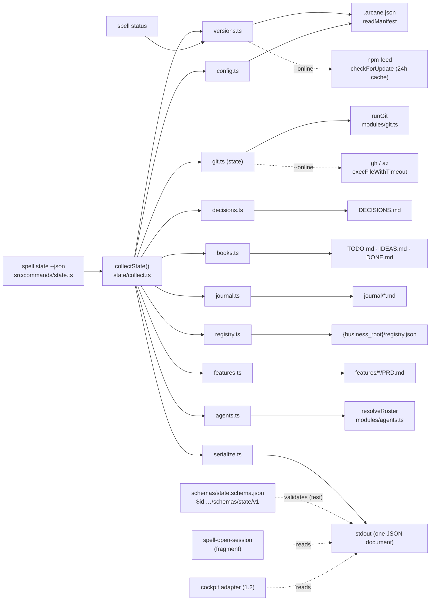
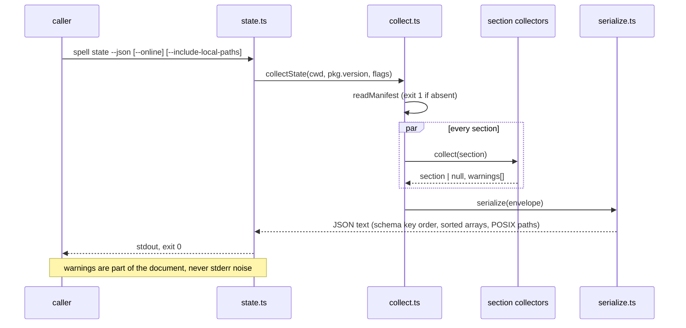

# Architecture — The State Export (`spell state --json`)

Source: [PRD.md](PRD.md) (accepted 2026-11-04, `275a0ea`). Decision implemented:
[ARC-044 — Client Architecture: Files-First State Contract and a Local Presence Channel](../../DECISIONS.md#arc-044--client-architecture-files-first-state-contract-and-a-local-presence-channel),
decision 1 only.

## Overview

One new command, `spell state --json`, backed by a new module folder `src/modules/state/` that
collects nine sections from facts the CLI already knows how to read, and a hand-written JSON
Schema shipped as a package asset that a test keeps in step with the TypeScript shape. Nothing
new is modelled: versions come out of `spell status`'s computation (moved, not copied), git
topology out of `runGit`, decision entries out of Show Report's parser (generalized), rosters
out of `resolveRoster`. The export is derived, deterministic, and makes no network request
unless `--online` is passed.

## Decisions

**D1 — A module folder, one file per section, one thin command.** `src/modules/state/` holds
`types.ts` (the TypeScript twin of the schema), `collect.ts` (the orchestrator: runs every
section collector, gathers `warnings[]`, assembles the envelope), one collector per section
(`versions.ts`, `git.ts`, `decisions.ts`, `books.ts` for TODO/IDEAS/DONE, `journal.ts`,
`config.ts`, `registry.ts`, `features.ts`, `agents.ts`), and `serialize.ts`.
`src/commands/state.ts` parses flags, calls `collectState`, prints. *Options:* one large module;
a folder. *Rationale:* Show Report (`src/modules/show-report/`) set the folder precedent for a
multi-source read model, and one file per section keeps each story to one file. *ADR:* none
needed.

**D2 — The schema is hand-written and the TypeScript type is its twin; a test is the parity
guard.** `src/assets/schemas/state.schema.json` (draft 2020-12, `$id`
`https://arcaneai.net/schemas/state/v1`, `additionalProperties: false` at the envelope) is
copied by `scripts/copy-assets.ts` to `dist/assets/schemas/`, which is inside the package's
`files: ["dist/"]`. `ajv` is added as a **devDependency only**; the test suite validates every
fixture output against the schema. *Options:* generate the schema from the types
(`ts-json-schema-generator`, a build step and a dev-dependency that shapes a public contract by
tooling defaults); generate the types from the schema; hand-maintain both with a validating test.
*Rationale:* the contract is the public artifact and must read as one; a build-generated schema
drifts with tool versions. The parity-guard obligation for a committed generated-adjacent
artifact (ARC-012 / ARC-027) is met by the validating test. *ADR:* none; ARC-037 decision 8's
zero-extra-install posture is respected (dev-dependency only).

**D3 — Versions are computed once, in `state/versions.ts`, and `status.ts` becomes a caller.**
`collectVersions(manifest, packageVersion, { online, feedUrl?, cachePath? })` returns the
`versions` section (`files`, `cli`, `latest`, `drift`, `components[]`). `runStatus` calls it
and renders exactly the table it renders today; the existing `status.test.ts` output assertions
are the byte-identity guard. `checkForUpdate`'s 24-hour cache in `~/.arcane/version-cache.json`
is reused unchanged, which gives the PRD's "once-per-day cache" optimisation for free. The
version-drift diagram generator (ARC-036) keeps its three-string signature; open-session feeds
it from the export. *ADR:* ARC-044 consequence 1, as written.

**D4 — Every git fact comes from `runGit` with its per-call timeout; two subcommands are
reclassified as reads.** `branch` (`symbolic-ref --short -q HEAD`, else `rev-parse --short HEAD`
with `detached: true`), `trunk` (`symbolic-ref refs/remotes/origin/HEAD`, else the first of
`main`/`master` that exists), `ahead`/`behind` (`rev-list --left-right --count
@{upstream}...HEAD`, `null` without an upstream), `uncommitted` (the existing
`countUncommittedChanges`), `worktrees[]` (`worktree list --porcelain`), `remote`
(`remote get-url origin`, host-matched to `github | ado | other`, userinfo stripped). `git.ts`'s
`AMBIGUOUS_AS_WRITE` set treats `worktree` and `remote` as writes; `classifyGitCommand` gains
the two read forms `worktree list` and `remote get-url` so they take the read budget. A
timeout or non-zero exit yields `null` for that field and one `warnings[]` entry (EF-20
hazard: a Windows file lock must never hang the export). *ADR:* none; this is the git
execution contract's own classification table extended by two rows.

**D5 — The decisions parser moves out of Show Report and learns every prefix.**
`show-report/decisions-parser.ts` matches only `^## ARC-(\d{3})`. It moves to
`state/decisions.ts` with the heading pattern `^## ([A-Z]{2,5})-(\d{3,})\b` and returns `id`,
`title` (heading text after the id and dash), `status` (first `**Status:**` line, first word),
`date` (first `**Date:**` line), and `anchor` (GitHub-style slug of the heading). Show Report
imports from the new location; its tests are unchanged. *Rationale:* the ops hub uses `ADR-`,
the cockpit `DMC-`, arcane `ARC-`; one parser, one place. *ADR:* none.

**D6 — Book items carry a content-hash locator, never a line number.** `books.ts` parses
`TODO.md`, `IDEAS.md` and `DONE.md`: a line matching `^\s*- \[( |x)\] ` is an item; `text` is
the line with the checkbox stripped, first 200 characters; `section` is the nearest preceding
heading; `locator` is `<section-slug>/<sha256(normalized text)[0..12]>`. It survives moves and
re-numbering and changes only when the text does, which is what ARC-040 asks of a durable
pointer. `open`/`done` counts are computed over the same items. *Options:* line numbers (drift
on every edit); ordinal within section (drifts on insert). *ADR:* none.

**D7 — `journal/` and `features/` are indexed from file names and frontmatter.** `journal.ts`
matches `journal/YYYY-MM-DD-<slug>.md`, `title` from frontmatter `title:` or the first `# `
heading. `features.ts` reads each `features/*/PRD.md`'s frontmatter (`title`, `status`,
`implementation_status`, `tracking`) with the YAML parser the roster loader already uses; a
PRD without frontmatter exports `null` fields and a warning. *ADR:* none.

**D8 — `--online` is one boolean threaded through `collectState`.** It enables exactly two
reads: `checkForUpdate` (D3) and the pull-request lookup. The PR lookup runs
`gh pr list --head <branch> --state open --json number,url,state` for a GitHub remote, or
`az repos pr list --source-branch <branch> --status active` for an ADO remote (launched through
`resolveAzureCli`), both via `execFileWithTimeout` and its `EXTERNAL_CLI_TIMEOUT_MS` budget, the
same path `push-safety.ts` already documents. Missing tool, no auth, timeout → `null` plus a
warning, exit 0. Without the flag both reads are skipped silently. *ADR:* PRD questions 3 and 4,
decided 2026-11-03/04.

**D9 — `local_path` is resolved by hostname against `clones`.** `registry.ts` reads
`{business_root}/registry.json` when `manifest.role === "hub"`, exports the venture fields the
PRD lists, and only with `--include-local-paths` adds `repos[].local_path` = the entry in
`clones` whose key equals `os.hostname()` case-insensitively (the hub registry uses `hulk`,
machines are named per the naming conventions). The `clones` map is never serialized.
*ADR:* ARC-030 decision 2 as it stands; the overlay follow-up is recorded in the PRD and
changes only this collector's *source*, not the field.

**D10 — The agents section is the resolved roster plus provenance.** `agents.ts` calls
`resolveRoster(targetDir, "repo")`; `origin` is `"user"` when `fromUserTier`, `definition_revision`
is `sha256:` + the hash of the role definition file under `definitionsDir`. Entries keep today's
fields (`definition`, `name`, `id`, `epithet`) under `agents.schema: "roster-v2"`.
`AgentRosterNotFoundError` → `agents: null`; `AgentConfigValidationError` → the loader's message
on stderr, exit 1 (PRD ST-12). The v3 fields are added by the identity ARC's own feature, never
here. *ADR:* ADR-110 (hub) decision 3 precedence, already implemented by ARC-047.

**D11 — Determinism by construction.** `serialize.ts` builds the envelope with object literals
in schema order, sorts every array by its declared key (`decisions` by `id`, `journal` by
`date` then `slug`, `features` by `slug`, `worktrees` by `path`, `components` by `name`,
registry ventures by `slug`), converts every path to POSIX relative to `repository.root`, and
prints `JSON.stringify(doc, null, 2)` plus a trailing newline. `generated_at` is the only field
that varies between runs on an unchanged repository. *ADR:* ARC-036's determinism rule,
applied to JSON.

**D12 — Failure model.** Three hard failures, all exit 1 with a one-line stderr message: no
manifest (the `spell status` wording), a malformed roster (D10), stdout not writable. Exit 2
only for `spell state` without `--json`. Everything else degrades to `null` + `warnings[]` and
exit 0, so a client never loses the whole document to one unreadable source.

**D13 — Open-session consumes the export through one fragment.** A new
`src/assets/.arcane/spells/_fragments/state-export.md` fragment, expanded by
`scripts/self-host-parity.ts` into `spell-open-session.md`'s Workspace Health Check, says: when
`spell state --json --online` is available, read the versions and git sections from it;
otherwise proceed as today. Prose only, no behaviour change when the command is absent. *ADR:*
ARC-039 shared fragments.

## Component Diagram

## Data Flow

## Testing Strategy

- **Framework:** Vitest (`npm test`), per `testing-standards.md`; coverage target 80% for
  `src/modules/state/**` and `src/commands/state.ts` (standard tier), evaluated by
  `npm run test:coverage` in CI.
- **Fixtures:** built with `test/helpers/git-fixture.ts` (real git in a temp dir) — a *consumer*
  (manifest without `role`, `DECISIONS.md` with `ADR-` entries, `TODO.md`, no roster), a *hub*
  (`role: hub`, `ventures/registry.json` with `clones` keyed by the test's own hostname and one
  foreign hostname, an `IDEAS.md`, a roster), and a *self-hosted* fixture (manifest
  `selfHosted: true`, `ARC-` entries, `features/*/PRD.md` with and without frontmatter,
  `DONE.md`, `journal/`). Variants: detached HEAD, no remote, a second worktree, an upstream
  three ahead / two behind, a remote URL with embedded userinfo.
- **Snapshots:** `toMatchSnapshot()` on the serialized text with `generated_at` replaced by a
  constant; run on the `ubuntu-latest`, `windows-latest`, `macos-latest` matrix in `ci.yml`.
- **Schema parity:** every fixture output validated with `ajv` against
  `src/assets/schemas/state.schema.json`; a deliberately extra key fails the test.
- **Byte identity:** `status.test.ts`'s existing output assertions run unchanged after the
  `collectVersions` refactor; one added test covers the four `drift` combinations.
- **Network:** `fetch` and `execFileWithTimeout` mocked; without `--online` both assert zero
  calls; with it, a mocked open PR populates `git.pull_request`, a mocked missing `gh` yields
  `null` + warning.
- **Leak scan:** `denylist-scan.ts` run over all fixture outputs with a test denylist
  containing the foreign hostname and a fake org token; the userinfo fixture asserts the
  credential is absent from the output.
- **Determinism:** two consecutive runs on a fixture compared after masking `generated_at`.
- **Failure model:** no manifest → exit 1 with the status wording; malformed roster → exit 1;
  `spell state` without `--json` → exit 2.

## Security Considerations

- No file bodies: collectors read titles, ids, first lines and frontmatter only (PRD ST-11).
- Remote URLs have userinfo stripped before serialization; a token in `origin`'s URL never
  reaches the document.
- Machine names and local paths are opt-in (`--include-local-paths`) and this-machine-only
  (D9); the `clones` map is never serialized (ARC-030 decision 6).
- No network by default; `--online` is explicit and documented (ARC-044 decision 5's privacy
  posture: nothing leaves the machine from a plain run).
- The export never writes a repository file; the only write is `checkForUpdate`'s existing
  cache under `~/.arcane/`, and only when `--online`.
- The threat-model template section ARC-044 consequence 4 asks for belongs to the presence
  channel, not this item.

## Implementation Notes

- Register the command in `src/index.ts` beside `status`: `.command("state")`,
  `.option("--json")`, `.option("--online")`, `.option("--include-local-paths")`; `targetDirFor`
  without `--user` (the user tier is out of scope).
- `ajv` goes in `devDependencies` only; `tsup` bundles nothing new.
- `scripts/copy-assets.ts` already copies all of `src/assets/`; adding `schemas/` needs no script
  change, but the copy-time secrets scan runs over it, so the schema's examples use ARC-031's
  fictional venture names.
- Frontmatter parsing reuses the YAML dependency `agent-loader.ts` imports; no new parser.
- Paths: use `real-path.ts` for `repository.root`, then `path.posix` for every relative path in
  the document; never emit a drive letter in a relative path.
- Hostname comparison: `os.hostname().toLowerCase()` against lower-cased `clones` keys.
- Version bump via `spell-bump` (minor: new command and new public asset); CHANGELOG entry
  under ARC-044 records schema `1.0.0` and the additive-only rule; README gains a short
  "State export" section linking the schema.
- `check:staged-org-tokens`, lint, both typechecks and `doctor --leaks` run on every commit
  (pre-commit hook); fixture content must pass the org-token scan.
