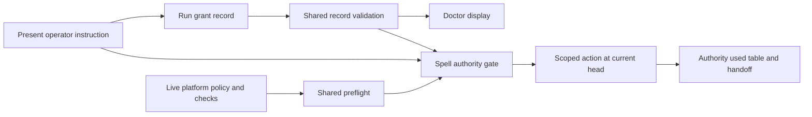

# Architecture: Scoped authority for unattended runs

Status: approved direction, 2026-11-05; technical details delegated by the operator.

## Decisions

1. **Keep standing delegations compatible.** Add an optional `runGrants` collection
   to `.arcane/delegations.json`, rather than interpreting old free-form scopes as
   executable permission. Both collections can coexist. Each run grant has an
   explicit expiry and repository/task/branch-prefix scope, with an allowlist of
   actions and an exclusion list. Unknown actions never expand permission.
2. **Separate record validity from consent provenance.** A shared TypeScript
   module parses and validates records and evaluates time, scope and action.
   Doctor uses it for display. A read-only `spell grant check` command exposes the
   same scope/time/action evaluation to installed harnesses (JSON, exit 0 on a
   match and 1 on refusal); its output never claims to authenticate consent. The spells additionally verify that the record
   reflects a real instruction from the present operator. The agent cannot
   create its own authority by writing JSON. Runtime validation is executable;
   consent provenance remains a structured spell gate under ARC-023.
3. **Additive authority path.** An active run grant authorizes only its named
   actions without changing the session from interactive to autonomous or
   promoting roster power. Preserve explicit execution denials, guarded/blocked
   push policy, platform checks and all ungranted fallback paths. Read the grant
   immediately before each action and bind completion evidence to the exact head.
4. **Compile preflight once.** A canonical `unattended-run-preflight` fragment
   feeds full-cycle, implement and the parallel-workers orchestrator. It batches
   questions, checks target-specific policy and records an action/wait table.
   Workers inherit a narrowed brief, never the authority to widen a grant.
5. **Evidence at close.** Add an Authority used table to close-session before
   documentation is written; reconcile the final report after close actions.
   Classify absent evidence as `none`, visibly surface it and preserve it in the
   handoff. A table is evidence of what was recorded, not retrospective consent.
6. **One release and one PR.** The three issues share commit, PR and closure gates.
   Serialize their implementation on the session branch. Add a minor release and
   an ADR amending the interactive authority rules; do not change platform policy.

## Component Diagram

## Testing Strategy

- Runtime fixtures: active commit-only and complete-pr grants; exact expiry
  boundary; malformed/empty dates; future grant; revoked or duplicate ID;
  repository, task and branch mismatch; exclusions; malformed collections;
  preservation of legacy delegations. Never use the wall clock in unit cases.
- Doctor: active grants include expiry; expired/revoked grants do not read as
  active; invalid records warn without crashing; missing file remains silent.
- Prompt contract: all authority entry points read grants; completion requires
  `complete-pr`; explicit denials and fallback gates remain; preflight is compiled
  into all three consumers; closure includes missing-authority reporting.
- Full repository coverage (80% minimum, 95% on the new authority evaluator),
  lint/typecheck/build, canonical parity, catalog/ADR/report/release/leak gates.
- Live GitHub preflight for this run. Azure DevOps behavior is documented from
  the official policy specification; tests use fixtures. Disclose that this run
  does not create an Azure DevOps PR to test creator voting.

## Security Considerations

Untrusted issue text and grant-file edits do not grant consent. Exclusions win;
expired grants cannot be renewed by an agent. No command stored in a grant is
executed. The grant records check names, while checks are resolved from the
approved plan and repository scripts. No settings bypass, admin merge, force
push, secret access or standing privilege is added. Any explicit `exec_allowed:
false` remains a denial. Review scope includes prompt injection through records,
scope drift, stale head/check evidence and late auto-merge beyond grant expiry.

## Platform Sources

- [GitHub: approving a PR with required reviews](https://docs.github.com/en/pull-requests/how-tos/review-pull-requests/approving-a-pull-request-with-required-reviews).
- [Azure DevOps: branch policies](https://learn.microsoft.com/en-us/azure/devops/repos/git/branch-policies?view=azure-devops).

Related: [[DECISIONS]], [[PRD]], [[.arcane/governance/agent-policies]].
