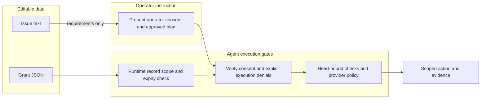

# Review: unattended-run authority

Reviewed 2026-11-05 by Codex in this session, with separate correctness and security
passes. This is not an independent human review or a GitHub approval.

| Lens | Verdict | Evidence |
| --- | --- | --- |
| Correctness | PASS | Scope is exact for repository/task; branch extensions require a delimiter; expiry is exclusive; exclusions win; completion permission is explicit. |
| Security | PASS for change; dependency WARN | File contents cannot authenticate consent. No command text from grants executes. Explicit execution denials and platform gates remain. No new dependency; audit reports 10 moderate advisories, no high/critical, in the unchanged dependency tree. |
| Performance | PASS | One small local JSON read and linear grant scan per action; no daemon or network request in record checking. |
| Tests | PASS | 3,107 passing tests, six existing skips; 93.74% overall line coverage; new validator and command handler 100% lines, branches and functions. |
| Naming/clarity | PASS | The command says record match rather than authorization; grant and standing delegation meanings stay distinct. |
| Architecture | PASS | One validator, shared compiled fragments, legacy compatibility, no standing power or platform-setting change. |

## Findings resolved

- **R1, Medium:** fingerprint-refresh prose after the interactive gate could still
  read as unconditional for a grant. Qualified those substeps as fallback-only;
  added explicit scope revalidation immediately before a granted commit.
- **R2, Low:** the decision log entry needed both a TOC row and a `Date` line for
  state export. Added them and verified the existing parser test.
- **R3, Low:** parallel-worker tests encoded an unconditional no-merge rule. Kept
  the worker restrictions and tested the explicit orchestrator-grant exception.
  Preserved the existing generic-body rule by keeping platform-source URLs in
  architecture.md rather than the compiled fragment.

- **R4, Medium:** exclusions initially used the same finite vocabulary as
  permissions, preventing the issue's examples (force-push/production/settings)
  from being recorded explicitly. Accept nonempty exclusion labels while keeping
  the permission allowlist closed; test that excluded operations remain ungrantable.

## Trust boundary

## Disclosure

Azure DevOps policy behavior is specified from Microsoft's official branch-policy
reference and covered by the shared prompt contract; no live ADO PR or creator vote
was made in this GitHub run. Prompt gates depend on a compliant agent and are not
a signed-capability or privileged-executor boundary. Auto-merge must be monitored
or replaced by revalidated direct completion before grant expiry.

Related: [[PRD]], [[architecture]], [[DECISIONS]].
